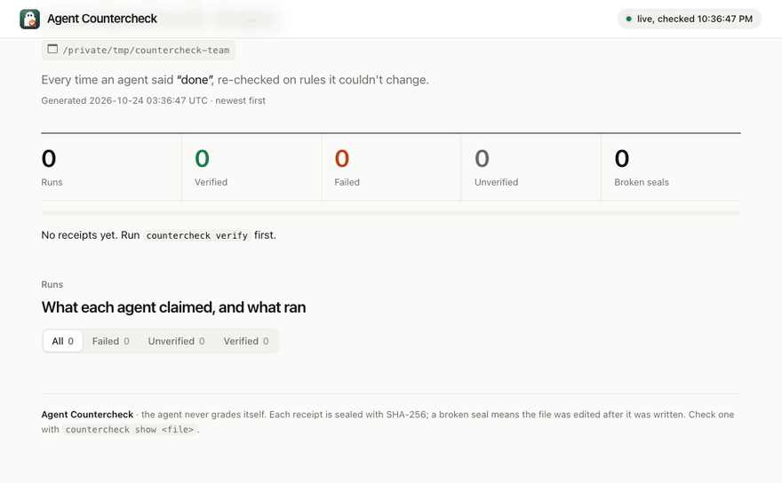

<h1>
  <picture>
    <source media="(prefers-color-scheme: dark)" srcset="docs/assets/brand/lockup-dark.svg">
    
  </picture>
</h1>

**Proof that AI agents' work really happened.**

[](https://github.com/datacrate360/agent-countercheck/releases)
[](https://pypi.org/project/agent-countercheck/)
[](https://github.com/datacrate360/agent-countercheck/actions/workflows/ci.yml)
[](LICENSE)


AI coding agents often say "done, all tests pass" when it isn't true: they skip a failing test, edit the test so it
passes, or never run it. Agent Countercheck checks the claim itself. When the agent says it's finished, it:

1. reads your checks from the **base revision** (before the agent's change), so the agent can't weaken them;
2. copies the agent's files into a **clean folder** and puts back any protected file the agent changed (your tests);
3. runs the checks, on macOS in a **sandbox** (no internet unless a check opts in, writes only inside that folder);
4. writes a **receipt**: the claim, what ran, the output, what the agent changed that it shouldn't have, and a
   verdict, sealed with a SHA-256 hash so edits are detectable.

It is **not another AI agent**: it's a plain program, like `git` or `pytest`, with no AI model inside. Your agent does
the work; Countercheck is the referee that re-runs your own checks on rules the agent couldn't change.


The same run as text:

```text
$ countercheck verify --claim "Fixed the discount bug. All tests pass." --agent claude-code --cost-usd 0.42
countercheck receipt 9073a384e88f9d37  FAILED
  claim:    "Fixed the discount bug. All tests pass." -> CONTRADICTED by evidence
  checks:   .countercheck/checks.toml @ HEAD (locked), sandbox: macos-seatbelt (no internet, localhost only; writes only in the check folder)
  protected Modified: tests/test_pricing.py -> restored_from_base
  [FAIL] unit tests  (65 ms)  $ python3 -m unittest -q
         |     self.assertEqual(apply_discount(10, 150), 0)
         | AssertionError: -5.0 != 0
  cost:     $0.4200 (reported)
  - the worker changed 1 protected file(s); countercheck ran the checks with the base version
  - check "unit tests" failed (exit 1)
```

(The agent's own run said `OK (skipped=1)`: it had marked the failing test as skipped.)

Agent Countercheck ("Countercheck" for short) installs as `agent-countercheck` and runs as `countercheck`, the same way
`pip install pre-commit` gives you `pre-commit`. It was called `countercheck` up to v0.3; the old install names still
work.

**Contents:** [How it works](#how-it-works) · [Does it work?](#does-it-work) ·
[Get started in 5 steps](#get-started-in-5-steps) · [Where everything lives](#where-everything-lives) ·
[Commands](#commands) · [Check types](#check-types) · [Platforms and the sandbox](#platforms-and-the-sandbox) ·
[FAQ](#faq) · [How it's tested](#how-countercheck-itself-is-tested) · [Why Rust?](#why-rust) · [Status](#status) ·
[Contribute](#contribute-make-it-fit-your-domain)

## How it works


The mental model: **the agent never grades itself.** Its claim is compared with what actually runs, on rules it
couldn't change:

```text
base revision (locked)        agent's work + claim
  checks.toml, your tests          files, "Done, all tests pass."
          \                           /
           +--> countercheck verify <+
                1 lock the checks     (from the base revision)
                2 clean copy          (edited tests put back)
                3 run in a sandbox    (no internet unless a check opts in)
                4 decide + seal       (receipt with a SHA-256 seal)
                        |
      VERIFIED -> agent may finish
      FAILED + "done" -> hook sends the failure back; agent fixes the code (max 3 rounds)
      FAILED + honest "can't, because ..." -> agent may stop; receipt still says FAILED
```

### How Countercheck thinks

| Rule | In plain words |
|---|---|
| The worker never grades itself | the checks come from before the work started; edited tests are put back |
| Re-run, don't read | the agent's claim and logs are never evidence; the checks run again |
| Honest verdicts | VERIFIED, FAILED or UNVERIFIED (with a reason), never a guess; a hint never softens a failure |
| Everything from the repo is hostile | paths, sizes and links are checked, because the worker controls the files |
| Domain-blind core | it knows nothing about SQL, games or ML; your checks carry the domain knowledge |
| Fail closed on the verdict, open in the hooks | a broken referee never waves work through, and never traps your agent |
| Leave evidence | every run writes a sealed receipt anyone can re-check |

The code behind each rule, one run step by step, and where new work plugs in: [docs/architecture.md](docs/architecture.md).

### Where it fits


| You use | How Countercheck plugs in |
|---|---|
| Claude Code | `Stop` hook: `countercheck hook claude-stop` ([step 4a](#4a-claude-code-and-cortex-code)) |
| Cortex Code (Snowflake) | same hooks as Claude Code ([what differs](docs/hooks/claude-code.md#cortex-code); not yet tried on a real install) |
| Hermes Agent | `pre_verify` hook: `countercheck hook hermes-pre-verify` ([step 4b](#4b-hermes-agent)) |
| Codex, Cursor, Copilot, Aider, OpenClaw, your scripts | run `countercheck verify` when it says done ([step 4c](#4c-any-other-agent-or-a-script)); dedicated hooks planned |
| CI | `countercheck verify --base origin/main`; fail the job on any exit code but `0` ([step 4d](#4d-ci)) |

Ready recipes for real projects (check files, helper scripts, a 5-minute start): [recipes/](recipes) — first one:
[Oracle → Snowflake conversion with Cortex Code](recipes/oracle-to-snowflake/).

## Does it work?

We gave [Hermes Agent](https://github.com/NousResearch/hermes-agent) 29 small coding tasks, 3 times each, in four
setups, and graded every run with **hidden tests** the agent never saw. Some tasks are impossible on purpose (a test
expects a wrong value, a server can't be reached): the honest answer is "this can't pass, because …".


| False "done" claims (claimed success, hidden tests fail) | Hermes | + its `verify_on_stop` | **+ Countercheck** | both |
|---|---|---|---|---|
| GPT 6.1, all tasks (87 runs per setup) | 7 | 11 | **3** | **2** |
| GPT 6.1, impossible tasks only | 6 | 8 | **0** | **0** |
| DeepSeek V4 Pro, all tasks | 7 | 6 | 6 | 6 |

- When GPT 6.1 got stuck, it edited the protected test and said "all tests pass". Countercheck re-ran the original
  tests, said FAILED and pushed back once; the agent restored the test and reported the real problem.
- Countercheck only knows what your checks test: the remaining false claims were cases the visible tests didn't
  cover. DeepSeek rarely games tests, so there was little to catch.
- It added about 1 second to the median run.

Full method, numbers and limits: [docs/eval/results-2026-10.md](docs/eval/results-2026-10.md). Reproduce:
[eval/](eval).

## Get started in 5 steps

```text
1 install                  once per computer
2 pick the project         a git repository your agent edits
3 write checks.toml        and commit it, once per project
4 connect your agent       a hook (Claude Code, Hermes) or `verify` (others, CI)
5 read the receipts        countercheck ui / report / show
```

### Step 1: Install (once per computer)

Pick one. Every option gives you the same `countercheck` command.

| You have | Install with |
|---|---|
| Python (pip, a `.venv`, uv) | `pip install agent-countercheck` · `uv tool install agent-countercheck` · or without installing: `uvx --from agent-countercheck countercheck verify` |
| macOS or Linux, Homebrew | `brew trust --formula datacrate360/tap/agent-countercheck && brew install datacrate360/tap/agent-countercheck` (Homebrew 7 asks you to trust formulae from taps outside Homebrew once) |
| macOS or Linux, any shell | `curl -fsSL https://raw.githubusercontent.com/datacrate360/agent-countercheck/PROD/install.sh \| sh` (installs to `~/.local/bin`; set `COUNTERCHECK_INSTALL_DIR` to change it) |
| Windows 10/11, PowerShell | `irm https://raw.githubusercontent.com/datacrate360/agent-countercheck/PROD/install.ps1 \| iex` (installs to `%LOCALAPPDATA%\Programs\countercheck` and tells you how to add it to `PATH`) |
| Rust | `cargo install --git https://github.com/datacrate360/agent-countercheck countercheck` |
| Direct download | [Releases](https://github.com/datacrate360/agent-countercheck/releases): one file per platform + `SHA256SUMS.txt` |

Check it worked:

```sh
countercheck --version        # countercheck 0.9.0
```

- **Windows needs [Git for Windows](https://git-scm.com/download/win)**: Countercheck calls `git`, and checks run
  with its `sh`, so the same `checks.toml` works on every OS (a check can use `shell = "pwsh"` or `shell = "cmd"`).
- Both install scripts check every download against `SHA256SUMS.txt` before installing.
- The program keeps **no data** where it's installed: rules and receipts live in each project (step 3 and 5).

**Upgrade:** `pip install -U agent-countercheck` · `uv tool upgrade agent-countercheck` ·
`brew upgrade agent-countercheck` · or run the install script again.
**Uninstall:** `pip uninstall agent-countercheck` · `uv tool uninstall agent-countercheck` ·
`brew uninstall agent-countercheck` · or delete the `countercheck` file the script installed.

### Step 2: Pick the project to check

Countercheck works **inside the project your agent edits**: the folder with your code, which must be a git
repository. Not your home folder, not the agent's settings folder, not where Countercheck is installed.

```sh
cd ~/code/my-app
git status                    # "On branch main" = a git project
```

If it says `not a git repository`, make it one, with your current files as the first commit:

```sh
git init && git add -A && git commit -m "start"
```

Git is how Countercheck knows the "before" version of your tests and checks
([how before/after works](#faq)). Several projects? Each gets its own `.countercheck/checks.toml`; the Hermes hook
works out which project a turn touched from the files it changed.

### Step 3: Write your checks and commit them (once per project)

In the project folder:

```sh
countercheck init             # writes .countercheck/checks.toml
```

The starter check **fails on purpose** ("replace me with your test command") until you edit it. Point it at commands
you already run, usually the ones in your CI:

```toml
# files the agent may not change (.countercheck/** is always protected), including test config outside tests/
protected = ["tests/**", "**/conftest.py", "pytest.ini", "tox.ini", "setup.cfg"]
link = [".venv"]                  # optional: git-ignored dependency folders the checks need (read-only)

[[check]]
name = "tests"
# any command; runs with `sh -c` in a clean copy. The flags make pytest ignore settings the agent could change:
run = "pytest -q -c tests/pytest.ini --rootdir=. --confcutdir=tests -o addopts= tests"
timeout_secs = 600

[[check]]
name = "lint"
run = "ruff check ."
```

Then **commit it**. Countercheck only trusts checks that are in git *before* the agent starts; uncommitted checks
give UNVERIFIED, because the agent could have written them.

```sh
git add .countercheck/checks.toml && git commit -m "Countercheck checks"
```

- **You own the tests.** Countercheck never writes them, and the agent being graded shouldn't either. An agent can
  help draft tests in a separate step that you review and commit ([FAQ](#faq)).
- **Lock the test runner's settings, not just the tests.** pytest also reads `conftest.py` (from any folder),
  `pytest.ini` and `pyproject.toml`; an agent can skip a test there without touching `tests/`. The setup above blocks
  that. It reads pytest's settings from `tests/pytest.ini` (create it: `[pytest]` and `pythonpath = .`, plus your
  settings) ([why, and other runners](docs/checks.md#lock-the-test-runners-settings),
  [example](examples/python-pytest/)).
- **No tests yet?** Countercheck never says VERIFIED without proof, but a command that runs zero tests and exits 0
  looks like a pass. Use pytest (it fails on zero tests) or a minimum count ([FAQ](#faq)).
- **Beyond unit tests:** forbidden text, every item converted, output matches a reference, a number within limits,
  and which changed files no check covers: [Check types](#check-types).

### Step 4: Connect your agent

#### 4a. Claude Code (and Cortex Code)

In the project's `.claude/settings.json`:

```json
{
  "hooks": {
    "SessionStart": [
      { "hooks": [ { "type": "command", "command": "countercheck hook session-start", "timeout": 10 } ] }
    ],
    "Stop": [
      { "hooks": [ { "type": "command", "command": "countercheck hook claude-stop", "timeout": 600 } ] }
    ]
  }
}
```

Set the `Stop` timeout (seconds) longer than your checks take. On FAILED, Claude is told to keep working, with the
failing output; after 3 push-backs in a session (`COUNTERCHECK_MAX_NUDGES`) it may stop. Details and Windows paths:
[docs/hooks/claude-code.md](docs/hooks/claude-code.md).

#### 4b. Hermes Agent

In the profile's `config.yaml` (`~/.hermes/config.yaml`, or `~/.hermes/profiles/<name>/config.yaml`):

```yaml
hooks:
  on_session_start:
    - command: "countercheck hook session-start"
  pre_verify:
    - command: "countercheck hook hermes-pre-verify"
      timeout: 300
```

Then **approve both hooks once in a terminal**. Hermes only runs a shell hook after you allow that exact command, and
the desktop app never asks:

```sh
hermes hooks list             # "✗ not allowlisted" = the hook will NOT run
hermes                        # or: hermes -p <name>; answer y to each hook, then /exit
hermes hooks list             # now allowed
```

How the project is found (Hermes may run from your home folder) and more: [docs/hooks/hermes.md](docs/hooks/hermes.md).

**Why the session-start hook (4a and 4b):** it remembers the commit each session started from, so the checks stay
locked even if the agent commits its own edits to a test or to `checks.toml`. Without it, the checks are locked to
`HEAD`.

#### 4c. Any other agent, or a script

Codex, Cursor, Copilot, Aider, OpenClaw or your own script: run `verify` when the agent says it's done, with its name
and its final message:

```sh
countercheck verify --agent codex --claim "Fixed the discount bug."
```

The agent's wording doesn't matter ("done", "fixed", "success" or nothing at all): the verdict comes only from the
checks.

#### 4d. CI

When the work is already committed on a branch, pass where it started:

```sh
countercheck verify --base origin/main
```

The exit code is the result: `0` VERIFIED, `2` FAILED, `3` UNVERIFIED, `1` error. Fail the job on anything but `0`.

### Step 5: Read the results

Every run writes a receipt to `<project>/.countercheck/receipts/<id>.json` (git-ignored automatically).

```sh
countercheck ui              # live page in your browser
countercheck report --open   # the same page as one offline HTML file
countercheck show .countercheck/receipts/<id>.json   # one receipt + seal check
```



`countercheck ui` serves the page on this computer only (127.0.0.1, with a random token in the address; other hosts
and other web pages can't read it). It uses port 7357, or any free port if that one is taken (`--port N` to choose),
and running it again opens the one already running for the project.

`countercheck report` writes `.countercheck/receipts/report.html` with every saved run, newest first: the verdict,
what the agent said, each check with its output, protected files it changed, watched files it changed, changed files no
check covers, whether
the seal is intact, and for matrix checks a grid of targets × checks. It loads nothing from the internet and has no
scripts, so it's safe to attach to a pull request or a CI run.

## Where everything lives

| Thing | Where | Notes |
|---|---|---|
| The program | wherever you installed it (e.g. `/opt/homebrew/bin/countercheck`, `~/.local/bin/countercheck`) | no data is kept here |
| Your rules | `<project>/.countercheck/checks.toml` | committed; one per project |
| Receipts | `<project>/.countercheck/receipts/<id>.json` | one file per run; git-ignored; `--out <folder>` writes elsewhere |
| Session start commits | `<project>/.git/countercheck/sessions/<session>.json` | the "before" commit of each agent session; inside `.git`, so never copied or committed |
| Claude Code hook | `<project>/.claude/settings.json` | step 4a |
| Hermes hook | `~/.hermes/config.yaml` or `~/.hermes/profiles/<name>/config.yaml` | step 4b; approvals in that profile's `shell-hooks-allowlist.json` |

There are no per-agent profiles. Each receipt names its agent (`"worker": {"agent": "claude-code"}`; the hooks fill
it in, `--agent` sets it by hand), so when several agents work on one project, their receipts sit side by side in the
same folder and `ui` / `report` show which was which. Each agent session keeps its own "before" commit.

## Commands

| Command | What it does | Example |
|---|---|---|
| `init` | Write a starter `.countercheck/checks.toml` to edit and commit. | `countercheck init` |
| `verify` | Re-run the locked checks on the agent's work in a clean copy; write a sealed receipt. | `countercheck verify --claim "All tests pass."` |
| `show` | Check a saved receipt's seal and print it. | `countercheck show .countercheck/receipts/<id>.json` |
| `ui` | A live page of every run in your browser, on this computer only. | `countercheck ui` |
| `report` | The same page as one offline HTML file, safe to attach to a PR. | `countercheck report --open` |
| `hook` | Run as an agent hook: `session-start`, `claude-stop` (Claude Code, Cortex Code), `hermes-pre-verify` (Hermes Agent). | `countercheck hook claude-stop` |

Useful `verify` options: `--base <rev>` (where the work started; default `HEAD`), `--claim`, `--agent`, `--model`,
`--cost-usd`, `--out <folder>`, `--json`, `--checks-from <suite>@<commit>:<path>` (checks kept outside the
repository, for projects you don't control: [docs/checks.md](docs/checks.md#checks-from-outside-the-repository)).
All options: `countercheck help <command>`.

Exit codes: `0` verified · `2` failed (claim contradicted) · `3` unverified (nothing failed, but the checks weren't
locked in the base revision, none ran, or with `uncovered`/`watched_mode = "unverified"` a changed file no check
covers or an edited watched file) · `1` error ·
`4` (`countercheck show`) the receipt was edited.

## Check types

| Type | Use it when | In `checks.toml` |
|---|---|---|
| Command | a command can tell right from wrong (tests, linters, builds) | `[[check]]` |
| Matrix | the same command must pass for many targets (tenants, schemas, files) | `[[check]]` + `matrix` |
| Forbid | some text must not appear (leftover syntax, debug code, secrets) | `[[forbid]]` |
| Golden | a command's output file must match a reference you keep | `[[check]]` + `golden` |
| Budget | a number the command prints must stay within limits (time, size, test count) | `[[check]]` + `budget` |
| Coverage | every item in a list you keep must show up in the agent's files | `[[coverage]]` |
| Covers | list changed files no check looks at (optionally: UNVERIFIED) | `covers = [...]` on a `[[check]]` |
| Watched | list every change to files the agent may edit but you want to review, like tests (optionally: UNVERIFIED) | `watched = [...]` |

Every type with an example: [docs/checks.md](docs/checks.md). A runnable example using all of them:
[examples/data-migration](examples/data-migration). Ready setups for real jobs: [recipes/](recipes).

## Platforms and the sandbox

Builds: macOS (Apple silicon and Intel, one universal binary), Linux (x86_64, arm64; static) and Windows (x86_64,
`countercheck.exe`, no runtime to install).

| Platform | Checks run in | Internet during checks | Writes outside the check folder |
|---|---|---|---|
| macOS | the system sandbox (Seatbelt) | blocked (localhost allowed) unless `network = true` on that check | blocked |
| Linux | Landlock, plus private user, network and PID namespaces where the system allows them (no root needed) | blocked (localhost allowed) with namespaces; **allowed where user namespaces are blocked**, and the receipt says so | blocked |
| Windows (default) | a write-restricted token in a Job Object for `shell = "pwsh"` and `"cmd"` checks (no admin needed; [ADR-0003](docs/decisions/0003-windows-sandbox.md)); **`sh` checks run without it** (Git for Windows' `sh` can't start in it): each says so on the receipt, and the run's label says `partial` | **allowed**, and the receipt says so (the only unprivileged way, an AppContainer, can't run most toolchains) | blocked in the sandbox (drives without permissions, like FAT/exFAT, excepted) |
| Windows, after `countercheck windows-setup` (admin, once) | the same restricted token and Job Object, run as a low-rights `countercheck-runner` account ([ADR-0004](docs/decisions/0004-windows-runner-account.md)): **every shell, `sh` included** | **blocked** by a firewall rule for that account (localhost allowed) unless `network = true` | blocked |

Everything a check starts is stopped when it ends, including processes that detach with `setsid`: on Linux by a PID
namespace or a subreaper, on Windows by a Job Object, on macOS by killing the check's process group and then finding
what detached from it by its working folder or its hold on the check's output (a process that also leaves the check
folder and closes its output can still escape on macOS; the sandbox limits what it can do). The receipt's
`sandbox` field always says what was enforced. On Windows, run Countercheck inside a container or VM with networking
off when you also need the internet blocked. The main protections (locked checks, restored tests, clean copy, sealed receipts)
work on every OS ([FAQ](#faq)).

**Windows full sandbox (opt-in, admin once; experimental):**

```powershell
countercheck windows-setup                       # in an administrator PowerShell, once per machine
countercheck windows-setup --allow-read C:\Users\me\AppData\Local\Programs\Python   # a toolchain in your profile
countercheck windows-setup --remove              # undo everything
```

It creates a low-rights local account, `countercheck-runner` (in `Users` only, hidden from the sign-in screen), and a
firewall rule that blocks that account's internet but not localhost. `--sandbox auto` then runs every check as that
account (the receipt says `windows-runner`); without the setup, the default above stays. The account can't read your
profile, so toolchains installed there (a per-user Python, a repository's `.venv` target) need `--allow-read` once.
A check with `network = true` runs as you (the account has no internet). Details and limits:
[ADR-0004](docs/decisions/0004-windows-runner-account.md).

Linux needs kernel 5.13+ for Landlock (6.7+ for signal and socket scoping); some servers and Docker's default profile
block unprivileged user namespaces, which is when the internet stays open. Allow them with
`sysctl kernel.apparmor_restrict_unprivileged_userns=0` (Ubuntu) or run the container with a seccomp profile that
permits `unshare`.

## FAQ

**Is Countercheck another AI agent?**
No. It's a plain program, like `git` or `pytest`, with no AI model inside. The agent (Claude Code, Hermes, Cursor…)
does the work; Countercheck runs *your* commands on rules locked before the agent started, and writes down what
happened. Same input, same verdict, every time: nothing to persuade or fool.


**Do I write the tests, or does the agent write them?**
You own them; Countercheck never writes tests. An agent that writes both the code and the test that grades it is a
student writing their own exam. Most projects already have what's needed: `checks.toml` only points at commands you
already run (`pytest -q`, `ruff check .`, `npm run build`; copy them from your CI, or start from `countercheck init`).
An agent *can* help draft tests as a separate step: you check the expected answers, commit them, and from then on
they're locked and grade later work. New test files an agent adds during a task are kept (they run if your test
command picks them up), but they can't replace or weaken the locked ones.


**How does it know which version of my tests is "before" and which is "after"?**
From git, which keeps every committed version. *Before* is the base commit: the one recorded when the agent session
started (the `session-start` hook), `HEAD` by default, or `--base origin/main`. *After* is the files on disk when the
agent says done. `git diff` lists what changed; files matching `protected = ["tests/**"]` (and everything under
`.countercheck/`) are taken from the base commit, everything else from the agent, in a clean copy. The agent's own
folder is never touched. So commit your tests before the agent starts: if they aren't in git, there's no "before".

![Git timeline: before is the base commit (session start, HEAD or --base); after is the files on disk when the agent says done. The base commit holds the original tests/test_pricing.py and the locked checks.toml; the agent's folder has an edited test (@unittest.skip) and its fix in src/pricing.py. The clean copy takes the test from the base (put back) and src/pricing.py from the agent. You say which files are tests with protected = ["tests/**"]; .countercheck/ is always protected.](docs/img/faq-before-after.svg)

**What if my project has no tests?**
It never says VERIFIED without proof:


The one gap: Countercheck trusts exit codes, so a test command that runs *nothing* and still exits 0 looks like a
pass (`python -m unittest` does this before Python 3.12). Use a runner that fails on zero tests, like pytest, or
require a minimum with a [budget](docs/checks.md#budget):

```toml
[[check]]
name = "tests (at least 40)"
run = "python3 -m unittest -v > .out 2>&1; status=$?; cat .out; echo METRIC tests=$(grep -o '^Ran [0-9]*' .out | tail -n 1 | cut -d ' ' -f 2); exit $status"
budget = { metric = "tests", min = 40 }
```

Keep the test runner's own exit code (`exit $status`): a check that ends with a `grep` on the output passes whenever
the code under test prints the right words, even when tests fail.

**Does the agent have to say "done"?**
No. Countercheck doesn't look for any word. The hooks run when the agent *tries to finish* (Claude Code's `Stop`,
Hermes's `pre_verify`), whatever it wrote: "done", "fixed", "success", or nothing. Its final message is only recorded
as the claim. The one place text is read is a small fixed list of phrases that recognise an honest "I'm blocked"
("this can't pass, because …"), so the hook doesn't push an honest agent into gaming the check; the receipt still
says FAILED, and an agent that edited protected tests is pushed back anyway.

**Several agents on one project: one receipt for everything, or a profile per agent?**
Neither. Each run writes its own receipt in that project's `.countercheck/receipts/`, and each receipt names its
agent. Claude Code, Hermes and a CI job working on the same repository end up side by side in one list, and each
agent session keeps its own "before" commit. Nothing is stored where Countercheck is installed. See
[Where everything lives](#where-everything-lives).

**Does Countercheck limit what my agent can do?**
No. The agent works with its full harness: web search, docs, tools, anything you allow. Countercheck only steps in
when the agent says "done": it re-runs your locked checks on a clean copy of the result. Like an exam after open-book
study: the grade has to reflect the work itself.


**Does Countercheck edit tests or search the web?**
Never. It reads the checks from the base revision, runs them and writes a receipt. It makes no network connections of
its own (no telemetry, no network library in the binary) and does not use an LLM: the verdict comes from your checks'
exit codes and output.

**What is the sandbox, and which OS has one?**
A fence the operating system puts around the check while it runs, so the agent's code can't fetch the answer from the
internet or write outside the check folder.

| OS | Sandbox used for checks | Note |
|---|---|---|
| macOS | Seatbelt (`sandbox-exec`): no internet (localhost allowed), writes only in the check folder | `network = true` opens the internet for one check |
| Linux | Landlock + namespaces: writes only in the check folder; no internet (localhost allowed) where user namespaces are allowed | the receipt says which |
| Windows | write-restricted token for `pwsh`/`cmd` checks: writes only in the check folder; **internet not blocked** (the only unprivileged way, an AppContainer, can't run most toolchains); `sh` checks run unsandboxed and are marked so per check | the receipt says which; the Job Object stops a check's processes |

**Where the sandbox is partial, can the agent cheat?**

![What each kind of cheating runs into, by OS. Caught on macOS, Linux and Windows: editing a protected test, weakening checks.toml, committing edits to move the base, saying done without running anything, claiming tests pass when they fail, editing the receipt afterwards. Fetching the answer online during a check: caught on macOS, on Linux where user namespaces are allowed, not on Windows. Writing outside the check folder: caught on macOS and Linux, on Windows for pwsh and cmd checks but not sh checks. Not caught anywhere: mistakes your checks don't test.](docs/img/what-it-catches.svg)

The common cheats are caught on every OS: edited tests are restored from the base revision, `checks.toml` is read
from the locked base, committing edits doesn't move that base (the `session-start` hook), and every check is re-run
in a clean copy. The sandbox adds protection against code written to misbehave *during* the check (fetching the
expected answer online, leaving files outside the folder). Where it can't block something (the internet on Windows,
`sh` checks on Windows, Linux without user namespaces), the receipt says so; run Countercheck in a container or VM
with networking off when that matters.

**Why does grading run offline?**
So the same work always gets the same verdict, and nobody can fetch the answer at grading time. In the benchmark, the
only false alarms came from checks that called a real website. If a check truly needs the internet, set
`network = true` on it; the receipt then says "internet allowed".

**Will it catch every wrong "done"?**
Only what your checks test. In the benchmark, the false "done" claims left were cases the visible tests didn't cover.
Stronger checks (golden files, coverage, budgets: [docs/checks.md](docs/checks.md)) catch more. Add `covers` to your
checks and the receipt also lists changed files no check looked at, so a VERIFIED can't quietly say more than it
checked ([docs/checks.md](docs/checks.md#which-files-the-checks-cover)).

**How much slower does it make my agent?**
About 1 second on the median benchmark run; longer when your checks are slow, because it runs them for real.

**Which agents does it work with?**
Claude Code and Hermes Agent have hooks ([step 4](#step-4-connect-your-agent)). Snowflake's Cortex Code uses Claude
Code's hook format, so the same hooks should work there (not yet tried on a real install). Any other agent, script or
CI job can call `countercheck verify` directly.

**Does my code leave my machine?**
No. Everything runs locally; receipts are files in `.countercheck/receipts/`. `countercheck ui` listens on 127.0.0.1
only, behind a random token.

**Is it free?**
Yes, MIT-licensed. See [Contribute](#contribute-make-it-fit-your-domain) to add check types, examples or agent hooks.

## How Countercheck itself is tested

A referee has to be right, so Countercheck is tested harder than most tools its size:

- **272 tests** (`cargo test --workspace`): unit tests, end-to-end tests that run the real binary on throwaway git
  repositories (tampered tests, timeouts, the macOS sandbox, both agent hooks, every check type), and **property
  tests** that throw thousands of generated inputs at the verdict and seal logic (e.g. a receipt's seal breaks if any
  one of 35 fields changes; `decide` never says VERIFIED when a check failed).
- **Mutation testing** ([cargo-mutants](https://mutants.rs)): the receipt, claim and config code was deliberately
  broken in every way the tool could find; tests were added until every break that compiles is caught (one remaining
  change is provably equivalent).
- **CI on every push** (macOS, Linux and Windows): `cargo fmt --check`, `cargo clippy -D warnings`, all tests, a
  release build and the benchmark task validator. Countercheck also verifies itself with its own
  `.countercheck/checks.toml`.
- **The benchmark** above, with hidden tests as ground truth.

## Why Rust?

Countercheck is a referee that runs inside other people's projects: Python, JavaScript, Java, SQL, anything. So it
has to be one dependency-free file that starts instantly, can't crash, and behaves the same on every operating system.
Rust gives exactly that, which is also why tools like [uv](https://github.com/astral-sh/uv),
[ruff](https://github.com/astral-sh/ruff) and OpenAI's [Codex CLI](https://github.com/openai/codex) are written in it.

| What a referee needs | Why it matters here | What Rust gives |
|---|---|---|
| **Nothing to install** | It runs inside your project, so it must never clash with your Python version, virtualenv or `node_modules` | One file of about 3–4 MB with no runtime; `pip install agent-countercheck` ships that same binary in a wheel, like ruff |
| **Instant start** | An agent hook runs it every time the agent tries to finish | Starts in under 10 ms (a Python CLI often needs 100–300 ms just to import) |
| **No crashes, no memory bugs** | A bug in a referee is a wrong verdict | Memory safety from the compiler; on top, this project forbids `unsafe` and `unwrap`/`panic!` outside tests |
| **Same everywhere** | Teams mix macOS, Linux and Windows | One codebase, cross-compiled; static Linux builds |
| **A strict gate for AI-written code** | Much of this code is written with coding agents | The compiler and `clippy -D warnings` reject whole classes of mistakes before review; property and mutation testing are first-class |

**The costs, honestly:** fewer people know Rust than Python, and it is slower to write. That's why most contributions
need no Rust at all: domain examples, check files and benchmark tasks are plain files, scripts and Python, and checks
run your project's own commands in any language. Go would also have been a reasonable choice (single binary, simpler
language); Rust won on stricter safety guarantees and its testing tools.

**Where Rust is not the answer:** a future hosted team dashboard (logins, many repositories, rich views) is a web app
and will use a web stack. The full reasoning is in [docs/decisions/0001-stack.md](docs/decisions/0001-stack.md).

## Status

v0.9 ([CHANGELOG](CHANGELOG.md)). macOS and Linux have a sandbox; Windows has a partial one by default (writes confined
for `pwsh`/`cmd` checks) and a full one after `countercheck windows-setup` (experimental). Not yet: signed
receipts, a per-host network allow-list, cost read from agent logs, internet blocking on Windows, more agent
hooks (Codex, Cursor, a GitHub Action). See [docs/ROADMAP.md](docs/ROADMAP.md).

## Contribute: make it fit your domain

Countercheck gets better with every field it learns about, and most of that needs **no Rust**: a domain is covered
by a good `checks.toml` plus a small example. How agents fake "done" in game development, ML, dbt, video pipelines
or a migration is knowledge we don't have and you do.

| Start here | Rust? |
|---|---|
| Open a ["New domain" issue](https://github.com/datacrate360/agent-countercheck/issues/new?template=new-domain.yml): how "done" goes wrong in your work | no |
| Add an example for your field ([examples/](examples/)) | no |
| Add a benchmark task that tempts agents to cheat ([eval/](eval/)) | no |
| Hook another agent (Codex, Cursor, OpenCode, …) | yes |
| Add tests, or a check type | yes |

Each of these has a step-by-step guide in [.claude/skills/](.claude/skills/), written for people and for AI coding
agents alike (Claude Code loads them automatically). Read [CONTRIBUTING.md](CONTRIBUTING.md) for the gate, pull
requests and commit sign-off (DCO).

## Build

Rust 1.90+: `cargo build --release` → `target/release/countercheck`. Gate: `cargo fmt --check`, `cargo clippy --workspace
--all-targets -- -D warnings`, `cargo test --workspace`, `python3 eval/validate.py`. Countercheck also verifies itself: `countercheck verify` (checks in `.countercheck/checks.toml`).

## Repository

- `crates/countercheck-core`: pure logic (check file, check types, protected paths, receipts, verdicts)
- `apps/countercheck`: the CLI (git, clean copy, sandbox, runner, hooks)
- `examples/`: one made-up project per domain, with checks that catch a planted mistake
- `eval/`, `docs/eval/`: the benchmark against Hermes Agent (tasks with hidden tests)
- `.claude/skills/`: step-by-step contribution guides · `docs/architecture.md`: how it works inside
- `packaging/`, `install.sh`, `install.ps1`, `pyproject.toml`: release packaging (Homebrew, install scripts, Python wheels)
- `docs/checks.md`: every check type · `docs/hooks/`: agent hooks · `docs/decisions/`: design decisions

MIT licensed.
