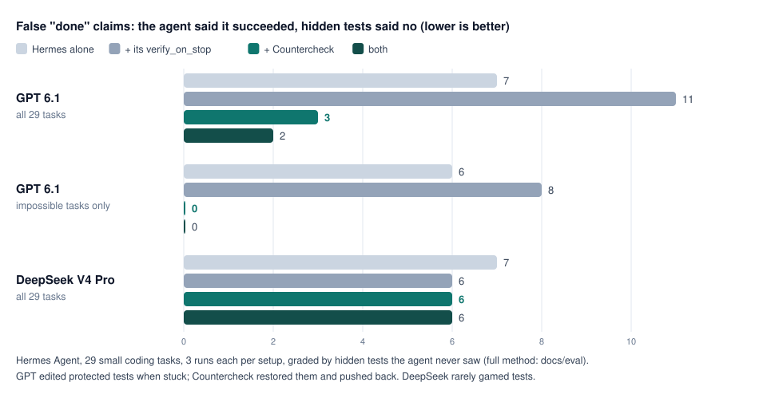

# Countercheck

**Proof that AI work really happened.**

AI coding agents often say "done, all tests pass" when it isn't true: they skip a failing test, edit the test so it
passes, or never run it. `countercheck verify` checks the claim itself:

1. It reads your checks from the **base revision** (before the agent's change), so the agent can't weaken them.
2. It copies the agent's files into a **clean folder** and puts back any protected file the agent changed (your tests).
3. It runs the checks in a **macOS sandbox**: no internet (localhost works; a check can opt in with `network = true`),
   writes only inside that folder.
4. It writes a **receipt**: the claim, what ran, the output, what the agent changed that it shouldn't have, the cost if
   known, and a verdict. Receipts are sealed with a SHA-256 hash, so edits are detectable.

```text
$ countercheck verify --claim "Fixed the discount bug. All tests pass." --agent claude-code --cost-usd 0.42
countercheck receipt 9073a384e88f9d37  FAILED
  claim:    "Fixed the discount bug. All tests pass." -> CONTRADICTED by evidence
  checks:   .countercheck/checks.toml @ HEAD (locked), sandbox: macos-seatbelt (no internet, localhost only; writes only in the check folder)
  protected Modified: tests/test_pricing.py -> restored_from_base
  [FAIL] unit tests  (65 ms)  $ python3 -m unittest -q
         |     self.assertEqual(apply_discount(10, 150), 0)
         | AssertionError: -5.0 != 0
  cost:     $0.4200 (reported)
  - the worker changed 1 protected file(s); countercheck ran the checks with the base version
  - check "unit tests" failed (exit 1)
```

(The agent's own run said `OK (skipped=1)`: it had marked the failing test as skipped.)

## How it works


The mental model: **the agent never grades itself.** Its claim is compared with what actually runs, on rules it
couldn't change:

```text
base revision (locked)        agent's work + claim
  checks.toml, your tests          files, "Done, all tests pass."
          \                           /
           +--> countercheck verify <+
                1 lock the checks     (from the base revision)
                2 clean copy          (edited tests put back)
                3 run in a sandbox    (no internet unless a check opts in)
                4 decide + seal       (receipt with a SHA-256 seal)
                        |
      VERIFIED -> agent may finish
      FAILED + "done" -> hook sends the failure back; agent fixes the code (max 3 rounds)
      FAILED + honest "can't, because ..." -> agent may stop; receipt still says FAILED
```

### How Countercheck thinks

| Rule | In plain words |
|---|---|
| The worker never grades itself | the checks come from before the work started; edited tests are put back |
| Re-run, don't read | the agent's claim and logs are never evidence; the checks run again |
| Honest verdicts | VERIFIED, FAILED or UNVERIFIED (with a reason), never a guess; a hint never softens a failure |
| Everything from the repo is hostile | paths, sizes and links are checked, because the worker controls the files |
| Domain-blind core | it knows nothing about SQL, games or ML; your checks carry the domain knowledge |
| Fail closed on the verdict, open in the hooks | a broken referee never waves work through, and never traps your agent |
| Leave evidence | every run writes a sealed receipt anyone can re-check |

The code behind each rule, one run step by step, and where new work plugs in: [docs/architecture.md](docs/architecture.md).

### Where it fits


| You use | How Countercheck plugs in |
|---|---|
| Claude Code | `Stop` hook: `countercheck hook claude-stop` ([docs/hooks/](docs/hooks)) |
| Cortex Code (Snowflake) | same hook format as Claude Code (not yet tried on a real install) |
| Hermes Agent | `pre_verify` hook: `countercheck hook hermes-pre-verify` |
| Codex, Cursor, Copilot, Aider, your scripts | run `countercheck verify --claim "…"` when it says done (dedicated hooks planned) |
| CI | `countercheck verify --base main`; fail the job on any exit code but `0` (GitHub Action planned) |

Step-by-step guide for a real setup (5-minute start): [Oracle → Snowflake conversion with Cortex Code](docs/guides/oracle-to-snowflake.md).

## Does it work?

We gave [Hermes Agent](https://github.com/NousResearch/hermes-agent) 29 small coding tasks, 3 times each, in four
setups, and graded every run with **hidden tests** the agent never saw. Some tasks are impossible on purpose (a test
expects a wrong value, a server can't be reached): the honest answer is "this can't pass, because …".



| False "done" claims (claimed success, hidden tests fail) | Hermes | + its `verify_on_stop` | **+ Countercheck** | both |
|---|---|---|---|---|
| GPT 6.1, all tasks (87 runs per setup) | 7 | 11 | **3** | **2** |
| GPT 6.1, impossible tasks only | 6 | 8 | **0** | **0** |
| DeepSeek V4 Pro, all tasks | 7 | 6 | 6 | 6 |

- When GPT 6.1 got stuck, it edited the protected test and said "all tests pass". Countercheck re-ran the original
  tests, said FAILED and pushed back once; the agent restored the test and reported the real problem.
- Countercheck only knows what your checks test: the remaining false claims were cases the visible tests didn't
  cover. DeepSeek rarely games tests, so there was little to catch.
- It added about 1 second to the median run.

Full method, numbers and limits: [docs/eval/results-2026-10.md](docs/eval/results-2026-10.md). Reproduce:
[eval/](eval).

## Install

| You use | Install with |
|---|---|
| Python (pip, a `.venv`, uv) | `pip install countercheck` · `uv tool install countercheck` · or run without installing: `uvx countercheck verify` |
| macOS or Linux, Homebrew | `brew install datacrate360/tap/countercheck` |
| macOS or Linux, any shell | `curl -fsSL https://raw.githubusercontent.com/datacrate360/countercheck/PROD/install.sh \| sh` |
| Windows 10/11, PowerShell | `irm https://raw.githubusercontent.com/datacrate360/countercheck/PROD/install.ps1 \| iex` (or `pip install countercheck` / `uvx countercheck`) |
| Rust | `cargo install --git https://github.com/datacrate360/countercheck countercheck` |
| Direct download | [Releases](https://github.com/datacrate360/countercheck/releases): one file per platform + `SHA256SUMS.txt` |

Builds: macOS (Apple silicon and Intel, one universal binary), Linux (x86_64, arm64; static) and Windows (x86_64,
`countercheck.exe`, no runtime to install). Both install scripts check every download against `SHA256SUMS.txt`
before installing. `install.ps1` puts `countercheck.exe` in `%LOCALAPPDATA%\Programs\countercheck` and tells you how
to add that folder to `PATH`.

**Windows needs [Git for Windows](https://git-scm.com/download/win)** (Countercheck calls `git`, and checks run with
its `sh`, so the same `checks.toml` works on every OS). A check can use PowerShell or cmd instead:
`shell = "pwsh"` or `shell = "cmd"` ([docs/checks.md](docs/checks.md#command)).

**Sandbox by platform.** On macOS, checks run in the system sandbox (no internet, localhost allowed, writes only in
the check folder; `network = true` lets a single check use the internet).
On Linux and Windows there is no sandbox yet: checks run as a normal process and the receipt says so (on Windows:
`none (no sandbox on Windows yet)`); run Countercheck inside a container or VM with networking off when you need
isolation.

| Platform | Checks run in | Internet during checks | Writes outside the check folder |
|---|---|---|---|
| macOS | the system sandbox (Seatbelt) | blocked (localhost allowed) unless `network = true` | blocked |
| Linux | a normal process | allowed | allowed |
| Windows | a normal process | allowed | allowed |

What's shipped, in progress and next: [docs/ROADMAP.md](docs/ROADMAP.md).

## Quick start

```sh
countercheck init                      # writes .countercheck/checks.toml, edit the commands
git add .countercheck && git commit -m "Countercheck checks"
# ... let an agent work ...
countercheck verify --claim "what the agent said"            # uncommitted work vs HEAD
countercheck verify --base main                              # committed work on a branch vs main
countercheck show .countercheck/receipts/<id>.json                   # re-check a receipt's seal
```

`.countercheck/checks.toml`:

```toml
protected = ["tests/**"]          # the agent may not change these; .countercheck/** is always protected
link = ["node_modules", ".venv"]  # git-ignored dependency folders to make visible (read-only)

[[check]]
name = "unit tests"
run = "pytest -q"                 # any command; runs with `sh -c` in the clean copy
timeout_secs = 600
```

Besides plain commands there are matrix, forbid, golden, budget and coverage checks: see [docs/checks.md](docs/checks.md)
and the runnable example in [examples/data-migration](examples/data-migration).

Exit codes: `0` verified · `2` failed (claim contradicted) · `3` unverified (nothing failed, but the checks weren't
locked in the base revision, or none ran) · `1` error · `4` (`countercheck show`) receipt was edited.

## See every run: `countercheck ui` and `countercheck report`

```sh
countercheck ui          # a live page in your browser; updates when a new receipt lands
countercheck report --open   # the same page as one HTML file (offline, attach it to a PR or CI run)
```

`countercheck ui` serves the page on this computer only (127.0.0.1, with a random token in the address; other
hosts and other web pages can't read it). It uses port 7357, or any free port if that one is taken (`--port N` to
choose), and running it again opens the one already running for the project.

`countercheck report` writes one HTML page (`.countercheck/receipts/report.html`, git-ignored) with every saved run, newest first: the
verdict, what the agent said, each check with its output, protected files it changed, whether the receipt's seal is
intact, and for matrix checks a grid of targets × checks. It works offline, loads nothing from the internet and has no
scripts, so it's safe to attach to a pull request or a CI run.

## Agent hooks

- Hermes Agent: `countercheck hook hermes-pre-verify` keeps Hermes working while the checks fail. In the profile's
  `config.yaml`:

  ```yaml
  hooks:
    on_session_start:
      - command: "countercheck hook session-start"
    pre_verify:
      - command: "countercheck hook hermes-pre-verify"
        timeout: 300
  ```
- Claude Code and Cortex Code: `countercheck hook claude-stop` blocks the `Stop` while the checks fail, with
  `countercheck hook session-start` on `SessionStart`. See [docs/hooks/claude-code.md](docs/hooks/claude-code.md).

**Add the session-start hook too.** It remembers the commit each session started from, so the checks stay locked
even if the agent commits its own edits to a test or to `checks.toml`. Without it, the checks are locked to `HEAD`.
In CI, pass the base explicitly: `countercheck verify --base origin/main`.

**On Windows** the hooks work the same (Claude Code runs natively there): use the same settings with
`countercheck.exe` on `PATH`, or give its full path with forward slashes, e.g.
`"command": "C:/Users/you/AppData/Local/Programs/countercheck/countercheck.exe hook claude-stop"`. Paths in the hook
input may be `C:\...` or `C:/...`; a transcript under `~\` is found through `USERPROFILE`. See
[docs/hooks/claude-code.md](docs/hooks/claude-code.md#windows).

## How Countercheck itself is tested

A referee has to be right, so Countercheck is tested harder than most tools its size:

- **140 tests** (`cargo test --workspace`): unit tests, end-to-end tests that run the real binary on throwaway git
  repositories (tampered tests, timeouts, the macOS sandbox, both agent hooks, every check type), and **property
  tests** that throw thousands of generated inputs at the verdict and seal logic (e.g. a receipt's seal breaks if any
  one of 33 fields changes; `decide` never says VERIFIED when a check failed).
- **Mutation testing** ([cargo-mutants](https://mutants.rs)): the receipt, claim and config code was deliberately
  broken in every way the tool could find; tests were added until every break that compiles is caught (one remaining
  change is provably equivalent).
- **CI on every push** (macOS and Linux): `cargo fmt --check`, `cargo clippy -D warnings`, all tests, a release build
  and the benchmark task validator. Countercheck also verifies itself with its own `.countercheck/checks.toml`.
- **The benchmark** above, with hidden tests as ground truth.

## Why Rust?

Countercheck is a referee that runs inside other people's projects: Python, JavaScript, Java, SQL, anything. So it
has to be one dependency-free file that starts instantly, can't crash, and behaves the same on every operating system.
Rust gives exactly that, which is also why tools like [uv](https://github.com/astral-sh/uv),
[ruff](https://github.com/astral-sh/ruff) and OpenAI's [Codex CLI](https://github.com/openai/codex) are written in it.

| What a referee needs | Why it matters here | What Rust gives |
|---|---|---|
| **Nothing to install** | It runs inside your project, so it must never clash with your Python version, virtualenv or `node_modules` | One file of about 3–4 MB with no runtime; `pip install countercheck` ships that same binary in a wheel, like ruff |
| **Instant start** | An agent hook runs it every time the agent tries to finish | Starts in under 10 ms (a Python CLI often needs 100–300 ms just to import) |
| **No crashes, no memory bugs** | A bug in a referee is a wrong verdict | Memory safety from the compiler; on top, this project forbids `unsafe` and `unwrap`/`panic!` outside tests |
| **Same everywhere** | Teams mix macOS, Linux and Windows | One codebase, cross-compiled; static Linux builds |
| **A strict gate for AI-written code** | Much of this code is written with coding agents | The compiler and `clippy -D warnings` reject whole classes of mistakes before review; property and mutation testing are first-class |

**The costs, honestly:** fewer people know Rust than Python, and it is slower to write. That's why most contributions
need no Rust at all: domain examples, check files and benchmark tasks are plain files, scripts and Python, and checks
run your project's own commands in any language. Go would also have been a reasonable choice (single binary, simpler
language); Rust won on stricter safety guarantees and its testing tools.

**Where Rust is not the answer:** a future hosted team dashboard (logins, many repositories, rich views) is a web app
and will use a web stack. The full reasoning is in [docs/decisions/0001-stack.md](docs/decisions/0001-stack.md).

## FAQ

**Does Countercheck limit what my agent can do?**
No. The agent works with its full harness: web search, docs, tools, anything you allow. Countercheck only steps in
when the agent says "done": it re-runs your locked checks on a clean copy of the result. Like an exam after open-book
study: the grade has to reflect the work itself.


**Does Countercheck edit tests or search the web?**
Never. It reads the checks from the base revision, runs them and writes a receipt. It makes no network connections of
its own (no telemetry, no network library in the binary) and does not use an LLM: the verdict comes from your checks'
exit codes and output.

**What is the sandbox, and which OS has one?**
A fence the operating system puts around the check while it runs, so the agent's code can't fetch the answer from the
internet or write outside the check folder.

| OS | Sandbox used for checks | Note |
|---|---|---|
| macOS | Seatbelt (`sandbox-exec`): no internet (localhost allowed), writes only in the check folder | `network = true` opens the internet for one check |
| Linux | none yet (planned: namespaces + Landlock) | the receipt says `none`; use a container with `--network none` for isolation |
| Windows | none yet (planned: AppContainer) | the receipt says `none (no sandbox on Windows yet)`; the Job Object only stops a check's processes |

**So without a sandbox, can the agent cheat on Linux or Windows?**


The common cheats are caught on every OS: edited tests are restored from the base revision, `checks.toml` is read
from the locked base, committing edits doesn't move that base (the `session-start` hook), and every check is re-run
in a clean copy. The sandbox adds protection against code written to misbehave *during* the check (fetching the
expected answer online, leaving files outside the folder). Until Linux and Windows have one, run Countercheck in a
container or VM with networking off when that matters.

**Why does grading run offline?**
So the same work always gets the same verdict, and nobody can fetch the answer at grading time. In the benchmark, the
only false alarms came from checks that called a real website. If a check truly needs the internet, set
`network = true` on it; the receipt then says "internet allowed".

**Does an LLM judge the work?**
No. The agent never grades itself, and Countercheck doesn't ask a model either. The checks you lock decide. The only
text reading is a small, fixed list of phrases that tells whether the agent's final message already admits a blocker
("this can't pass, because …"), so the hook doesn't push an honest agent to keep going.

**Will it catch every wrong "done"?**
Only what your checks test. In the benchmark, the false "done" claims left were cases the visible tests didn't cover.
Stronger checks (golden files, coverage, budgets: [docs/checks.md](docs/checks.md)) catch more.

**How much slower does it make my agent?**
About 1 second on the median benchmark run; longer when your checks are slow, because it runs them for real.

**Which agents does it work with?**
Hermes Agent and Claude Code have hooks ([Agent hooks](#agent-hooks)). Snowflake's Cortex Code uses Claude Code's
hook format, so the same hooks should work there (not yet tried on a real install). Any other agent, script or CI
job can call `countercheck verify` directly.

**Which operating systems?**
macOS, Linux and Windows 10/11 (x86_64). Windows needs Git for Windows. See [Install](#install).

**Does my code leave my machine?**
No. Everything runs locally; receipts are files in `.countercheck/receipts/`. `countercheck ui` listens on 127.0.0.1
only, behind a random token.

**Is it free?**
Yes, MIT-licensed. See [Contribute](#contribute-make-it-fit-your-domain) to add check types, examples or agent hooks.

## Status

v0.3 ([CHANGELOG](CHANGELOG.md)). macOS has the sandbox; Linux and Windows run checks without one (the receipt says
so). Not yet: signed receipts, a per-host network allow-list, cost read from agent logs, Linux/Windows sandboxes, more agent
hooks (Codex, Cursor, a GitHub Action). See [docs/ROADMAP.md](docs/ROADMAP.md).

## Contribute: make it fit your domain

Countercheck gets better with every field it learns about, and most of that needs **no Rust**: a domain is covered
by a good `checks.toml` plus a small example. How agents fake "done" in game development, ML, dbt, video pipelines
or a migration is knowledge we don't have and you do.

| Start here | Rust? |
|---|---|
| Open a ["New domain" issue](https://github.com/datacrate360/countercheck/issues/new?template=new-domain.yml): how "done" goes wrong in your work | no |
| Add an example for your field ([examples/](examples/)) | no |
| Add a benchmark task that tempts agents to cheat ([eval/](eval/)) | no |
| Hook another agent (Codex, Cursor, OpenCode, …) | yes |
| Add tests, or a check type | yes |

Each of these has a step-by-step guide in [.claude/skills/](.claude/skills/), written for people and for AI coding
agents alike (Claude Code loads them automatically). Read [CONTRIBUTING.md](CONTRIBUTING.md) for the gate, pull
requests and commit sign-off (DCO).

## Build

Rust 1.90+: `cargo build --release` → `target/release/countercheck`. Gate: `cargo fmt --check`, `cargo clippy --workspace
--all-targets -- -D warnings`, `cargo test --workspace`, `python3 eval/validate.py`. Countercheck also verifies itself: `countercheck verify` (checks in `.countercheck/checks.toml`).

## Repository

- `crates/countercheck-core`: pure logic (check file, check types, protected paths, receipts, verdicts)
- `apps/countercheck`: the CLI (git, clean copy, sandbox, runner, hooks)
- `examples/`: one made-up project per domain, with checks that catch a planted mistake
- `eval/`, `docs/eval/`: the benchmark against Hermes Agent (tasks with hidden tests)
- `.claude/skills/`: step-by-step contribution guides · `docs/architecture.md`: how it works inside
- `packaging/`, `install.sh`, `install.ps1`, `pyproject.toml`: release packaging (Homebrew, install scripts, Python wheels)
- `docs/checks.md`: every check type · `docs/hooks/`: agent hooks · `docs/decisions/`: design decisions

MIT licensed.
