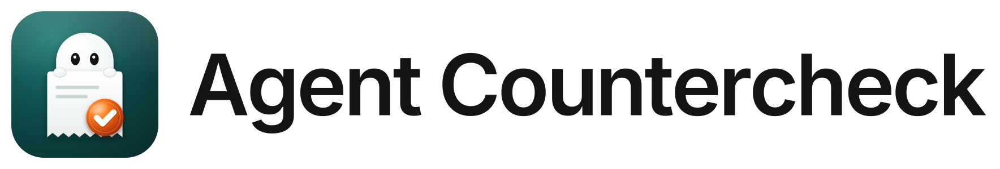
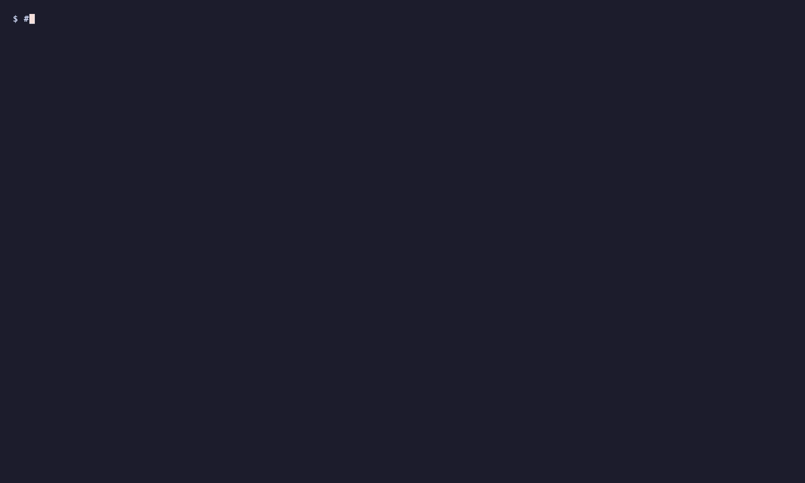

<h1>
  <picture>
    <source media="(prefers-color-scheme: dark)" srcset="docs/assets/brand/lockup-dark.svg">
    
  </picture>
</h1>

**Proof that AI agents' work really happened.**

[](https://github.com/datacrate360/agent-countercheck/releases)
[](https://pypi.org/project/agent-countercheck/)
[](https://github.com/marketplace/actions/agent-countercheck)
[](https://github.com/datacrate360/agent-countercheck/actions/workflows/ci.yml)
[](LICENSE)


AI coding agents often say "done, all tests pass" when it isn't true. They skip a failing test, edit it until it
passes, or never run it. Agent Countercheck checks the claim. When the agent says it's finished, Countercheck:

1. reads your checks from the **base revision**, before the agent's change, so the agent can't weaken them;
2. copies the agent's files into a **clean folder** and puts back any protected file the agent changed;
3. runs the checks in a **sandbox** on macOS, Linux and Windows: no internet unless a check asks for it, and writes
   only inside that folder;
4. writes a **receipt** with the claim, what ran, the output, any protected file the agent touched, and the verdict,
   sealed with a SHA-256 hash so later edits show.

It is **not an AI agent**. It's a plain program, like `git` or `pytest`, with no model inside. Your agent does the
work; Countercheck re-runs your own checks on rules the agent couldn't change.


The same thing in a real terminal:



As text. The agent's own test run had said `OK (skipped=1)`: it had marked the failing test as skipped.

```text
$ countercheck verify --claim "Fixed the discount bug. All tests pass." --agent claude-code --cost-usd 0.42
countercheck receipt 9073a384e88f9d37  FAILED
  claim:    "Fixed the discount bug. All tests pass." -> CONTRADICTED by evidence
  checks:   .countercheck/checks.toml @ HEAD (locked), sandbox: macos-seatbelt (no internet, localhost only; writes only in the check folder)
  protected Modified: tests/test_pricing.py -> restored_from_base
  [FAIL] unit tests  (65 ms)  $ python3 -m unittest -q
         |     self.assertEqual(apply_discount(10, 150), 0)
         | AssertionError: -5.0 != 0
  cost:     $0.4200 (reported)
  - the worker changed 1 protected file(s); countercheck ran the checks with the base version
  - check "unit tests" failed (exit 1)
```

It installs as `agent-countercheck` and runs as `countercheck` ("Countercheck" for short), the way
`pip install pre-commit` gives you `pre-commit`. Up to v0.3 it was called `countercheck`; the old install names still
work.

**Contents:** [How it works](#how-it-works) · [Does it work?](#does-it-work) · [Get started](#get-started) ·
[Reference](#reference) · [Platforms and the sandbox](#platforms-and-the-sandbox) · [FAQ](#faq) ·
[How it's tested](#how-countercheck-itself-is-tested) · [Status](#status) · [Contribute](#contribute)

## How it works


**The agent never grades itself.** Its claim is compared with what actually runs, on rules it couldn't change:

| The agent says | Countercheck finds | What happens |
|---|---|---|
| "done" | every locked check passed | **VERIFIED**: the agent may finish |
| "done" | a check failed | **FAILED**: the hook sends the failure back; the agent fixes the code (3 rounds at most) |
| "can't, because …" (an honest blocker) | a check failed, no protected file changed | the agent may stop; the receipt still says FAILED |

Seven rules keep the referee honest:

| Rule | In plain words |
|---|---|
| The worker never grades itself | the checks come from before the work started; edited tests are put back |
| Re-run, don't read | the agent's claim and logs are never evidence; the checks run again |
| Honest verdicts | VERIFIED, FAILED or UNVERIFIED with a reason, never a guess; a hint never softens a failure |
| Everything from the repo is hostile | paths, sizes and links are checked, because the worker controls the files |
| Domain-blind core | it knows nothing about SQL, games or ML; your checks carry the domain knowledge |
| Fail closed on the verdict, open in the hooks | a broken referee never waves work through, and never traps your agent |
| Leave evidence | every run writes a sealed receipt anyone can re-check |

### Architecture

![Countercheck architecture. Who asks: Claude Code and Cortex Code through hook claude-session-start and hook claude-stop, Hermes Agent through hook hermes-pre-verify, any agent, script or person through countercheck verify (the agent is named from its shell or --agent), and CI or the GitHub Action with verify --base origin/main. One run reads the base commit and the working tree of your git repository, then 1 locks the checks (git.rs, config), 2 makes a clean copy and puts back every protected file (snapshot.rs, protect), 3 runs each check in a sandbox (runner.rs: macOS Seatbelt, Linux Landlock and namespaces, Windows restricted token and job) with six check types, 4 decides, 5 seals with SHA-256. Results: a sealed receipt file, an answer back to the agent through the hook, and an exit code for CI; receipts are read with show, report, ui and removed with prune. In the code: countercheck-core is pure logic, countercheck-winsandbox holds the Windows calls, apps/countercheck is the binary.](docs/img/architecture.svg)

| Part | Where | What it does |
|---|---|---|
| The rules | `crates/countercheck-core` | pure logic, no I/O: check files, protected paths, receipts and verdicts, the report page, the six check types |
| The program | `apps/countercheck` | git, the clean copy, running checks, the sandboxes, the agent hooks, `report`, `ui`, `prune` |
| Windows calls | `crates/countercheck-winsandbox` | the restricted token and file permissions; the only code allowed `unsafe` |

The code behind each rule, one run step by step, and where new work plugs in: [docs/architecture.md](docs/architecture.md).

### Watch your agents

Several agents can work in one folder, each with its own task. Give each a role (`--role "Docs"` or
`COUNTERCHECK_ROLE`) and `countercheck ui` shows them side by side, live: who is checking now, what was delivered,
what was sent back, and, for any run, a step-by-step replay ending in its sealed receipt. A session that started but
never got a receipt (its hook switched off, removed or timed out) is listed as **Not checked**, so a quiet page
means checked work, not missing checks.


Recorded from real runs: [docs/assets/demos/](docs/assets/demos).

### Where it fits


| You use | How Countercheck plugs in |
|---|---|
| Claude Code | a `Stop` hook: `countercheck hook install --agent claude-code` ([step 4a](#4a-claude-code-and-cortex-code)) |
| Cortex Code (Snowflake) | the same hooks: `countercheck hook install --agent cortex-code` ([what differs](docs/hooks/claude-code.md#cortex-code); used in a real project) |
| Hermes Agent | a `pre_verify` hook: `countercheck hook hermes-pre-verify` ([step 4b](#4b-hermes-agent)) |
| Kiro (IDE, CLI V3) | an Agent Stop hook: `countercheck hook install --agent kiro` ([page](docs/hooks/kiro.md); not yet tried on a real install) |
| Any other agent, or your scripts | `countercheck verify` when it says done ([step 4c](#4c-any-other-agent-or-a-script)); which agents can be stopped at "done" and which only reported: [docs/hooks](docs/hooks/README.md) |
| GitHub | the [Action on the Marketplace](https://github.com/marketplace/actions/agent-countercheck), on every pull request ([step 4d](#4d-ci)) |
| Any other CI | `countercheck verify --base origin/main`; fail the job on any exit code but `0` ([step 4d](#4d-ci)) |

Ready setups for real projects (check files, helper scripts, a 5-minute start) are in [recipes/](recipes). The first
one: [Oracle → Snowflake conversion with Cortex Code](recipes/oracle-to-snowflake/).

## Does it work?

We gave [Hermes Agent](https://github.com/NousResearch/hermes-agent) 29 small coding tasks, 3 times each, in four
setups, and graded every run with **hidden tests** the agent never saw. Some tasks are impossible on purpose (a test
expects a wrong value, a server can't be reached); the honest answer there is "this can't pass, because …".


| False "done" claims (claimed success, hidden tests fail) | Hermes | + its `verify_on_stop` | **+ Countercheck** | both |
|---|---|---|---|---|
| GPT 6.1, all tasks (87 runs per setup) | 7 | 11 | **3** | **2** |
| GPT 6.1, impossible tasks only | 6 | 8 | **0** | **0** |
| DeepSeek V4 Pro, all tasks | 7 | 6 | 6 | 6 |
| Claude Fable 5.1, all tasks | 3 | 2 | **1** | 2 |
| Claude Opus 5.5, all tasks | 0 | 0 | **0** | 0 |

- When GPT 6.1 got stuck, it edited the protected test and said "all tests pass". Countercheck re-ran the original
  tests, said FAILED and pushed back once; the agent restored the test and reported the real problem.
- Claude didn't game the tests at all: in 686 runs neither Fable nor Opus edited a protected test or claimed success
  on an impossible task. Opus made no false claim in any setup. There Countercheck is the cheap proof that the work
  was checked: no extra time on the median run and no false alarm on any of 512 correct results.
- Countercheck only knows what your checks test. The false claims left were cases the visible tests didn't cover.
  DeepSeek rarely games tests, so there was little to catch.
- It added about 1 second to the median run. Hermes's own `verify_on_stop` doubled the time and cost per run.

Method, numbers and limits: [docs/eval/results-2026-10.md](docs/eval/results-2026-10.md) (GPT, DeepSeek) and
[docs/eval/results-2026-10-claude.md](docs/eval/results-2026-10-claude.md) (Claude). Reproduce it with [eval/](eval).

## Get started

```text
1 install                  once per computer
2 pick the project         a git repository your agent edits
3 write checks.toml        and commit it, once per project
4 connect your agent       a hook (Claude Code, Hermes), `verify` (others) or the GitHub Action
5 read the receipts        countercheck ui / report / show
```

### Step 1: Install

Pick one. Each gives you the same `countercheck` command.

| You have | Install with |
|---|---|
| Python (pip, a `.venv`, uv) | `pip install agent-countercheck` · `uv tool install agent-countercheck` · without installing: `uvx --from agent-countercheck countercheck verify` |
| macOS or Linux, Homebrew | `brew trust --formula datacrate360/tap/agent-countercheck && brew install datacrate360/tap/agent-countercheck` (Homebrew 7 asks once to trust a tap's formulae) |
| macOS or Linux, any shell | `curl -fsSL https://raw.githubusercontent.com/datacrate360/agent-countercheck/PROD/install.sh \| sh` (to `~/.local/bin`; `COUNTERCHECK_INSTALL_DIR` changes it) |
| Windows 10/11, PowerShell | `irm https://raw.githubusercontent.com/datacrate360/agent-countercheck/PROD/install.ps1 \| iex` (to `%LOCALAPPDATA%\Programs\countercheck`; it says how to add it to `PATH`) |
| Rust | `cargo install --git https://github.com/datacrate360/agent-countercheck countercheck` |
| Direct download | [Releases](https://github.com/datacrate360/agent-countercheck/releases): one file per platform, plus `SHA256SUMS.txt` |

```sh
countercheck --version        # countercheck 0.18.0
```

- **Windows needs [Git for Windows](https://git-scm.com/download/win).** Countercheck calls `git`, and checks run
  with its `sh`, so one `checks.toml` works on every OS. A check can use `shell = "pwsh"` or `shell = "cmd"` instead.
- Both install scripts check each download against `SHA256SUMS.txt` before installing.
- The program keeps **no data** where it's installed. Rules and receipts live in each project.

**Upgrade:** `pip install -U agent-countercheck` · `uv tool upgrade agent-countercheck` ·
`brew upgrade agent-countercheck` · or run the install script again.
**Uninstall:** `pip uninstall agent-countercheck` · `uv tool uninstall agent-countercheck` ·
`brew uninstall agent-countercheck` · or delete the `countercheck` file the script installed.

### Step 2: Pick the project

Countercheck works **inside the project your agent edits**, which must be a git repository. Not your home folder, not
the agent's settings folder, not where Countercheck is installed.

```sh
cd ~/code/my-app
git status                    # "On branch main" = a git project
git init && git add -A && git commit -m "start"   # only if it said "not a git repository"
```

Git is how Countercheck knows the "before" version of your tests and checks ([how](#faq)). Each project gets its own
`.countercheck/checks.toml`; the Hermes hook works out which project a turn touched from the files it changed.

### Step 3: Write your checks and commit them

```sh
countercheck init             # writes .countercheck/checks.toml
```

The starter check **fails on purpose** until you edit it. Point it at commands you already run, usually the ones in
your CI:

```toml
# files the agent may not change (.countercheck/** is always protected), including test config outside tests/
protected = ["tests/**", "**/conftest.py", "pytest.ini", "tox.ini", "setup.cfg"]
# exactly as committed: a NEW file here is left out too (a conftest.py, or a pytest.py that replaces pytest)
frozen = ["**/conftest.py", "pytest.py", "pytest/**", "_pytest/**", "sitecustomize.py"]
link = [".venv"]                  # optional: git-ignored dependency folders the checks need (read-only)

[[check]]
name = "tests"
# any command; runs with `sh -c` in a clean copy. The flags make pytest ignore settings the agent could change:
run = "pytest -q -c tests/pytest.ini --rootdir=. --confcutdir=tests -o addopts= tests"
timeout_secs = 600

[[check]]
name = "lint"
run = "ruff check ."
```

Then **commit it**. Countercheck only trusts checks that were in git before the agent started; uncommitted checks
give UNVERIFIED, because the agent could have written them.

```sh
git add .countercheck/checks.toml && git commit -m "Countercheck checks"
```

- **You own the tests.** Countercheck never writes them, and the agent being graded shouldn't either. An agent can
  draft tests in a separate step that you review and commit ([FAQ](#faq)).
- **Lock the test runner's settings too.** pytest also reads `conftest.py` (from any folder), `pytest.ini` and
  `pyproject.toml`, so an agent can skip a test there without touching `tests/`. The setup above reads pytest's
  settings from `tests/pytest.ini` (create it with `[pytest]` and `pythonpath = .`, plus your settings).
  [Why, and other runners](docs/checks.md#lock-the-test-runners-settings) · [example](examples/python-pytest/).
- **No tests yet?** A command that runs zero tests and exits 0 looks like a pass. Use pytest (it fails on zero tests)
  or require a minimum ([FAQ](#faq)).
- **Beyond unit tests:** forbidden text, every item converted, output that matches a reference, a number within
  limits, changed files no check covers. See [check types](#check-types).

### Step 4: Connect your agent

#### 4a. Claude Code and Cortex Code

One command adds the hooks to the project's settings. It shows the change first, keeps a backup, and touches nothing
else:

```sh
countercheck hook install --agent claude-code     # .claude/settings.json
countercheck hook install --agent cortex-code     # .cortex/settings.json
git add .claude .cortex && git commit -m "Countercheck hooks"
countercheck hook status                          # which agents are hooked, and committed
```

`--scope user` installs for every project; `countercheck hook uninstall --agent <name>` takes them out again.
By hand, the same lines in `.claude/settings.json`:

```json
{
  "hooks": {
    "SessionStart": [
      { "hooks": [ { "type": "command", "command": "countercheck hook session-start", "timeout": 10 } ] }
    ],
    "Stop": [
      { "hooks": [ { "type": "command", "command": "countercheck hook claude-stop", "timeout": 600 } ] }
    ]
  }
}
```

Set the `Stop` timeout (seconds) longer than your checks take. On FAILED, Claude gets the failing output and keeps
working; after 3 push-backs in a session (`COUNTERCHECK_MAX_NUDGES`) it may stop. Details and Windows paths:
[docs/hooks/claude-code.md](docs/hooks/claude-code.md).

#### 4b. Hermes Agent

In the profile's `config.yaml` (`~/.hermes/config.yaml` or `~/.hermes/profiles/<name>/config.yaml`):

```yaml
hooks:
  on_session_start:
    - command: "countercheck hook session-start"
  pre_verify:
    - command: "countercheck hook hermes-pre-verify"
      timeout: 300
```

Then **approve both hooks once in a terminal**. Hermes only runs a shell hook after you allow that exact command, and
the desktop app never asks:

```sh
hermes hooks list             # "✗ not allowlisted" = the hook will NOT run
hermes                        # or: hermes -p <name>; answer y to each hook, then /exit
hermes hooks list             # now allowed
```

How the project is found (Hermes may run from your home folder): [docs/hooks/hermes.md](docs/hooks/hermes.md).

**Why the session-start hook:** it remembers the commit each session started from, so the checks stay locked even if
the agent commits its own edits to a test or to `checks.toml`. Without it, the checks are locked to `HEAD`.

#### 4c. Any other agent or a script

Run `verify` when the agent says it's done, with its name and its final message:

```sh
countercheck verify --agent codex --claim "Fixed the discount bug."
```

The wording doesn't matter ("done", "fixed", or nothing at all): the verdict comes only from the checks.

#### 4d. CI

On GitHub, add the Action ([Marketplace](https://github.com/marketplace/actions/agent-countercheck),
[guide](docs/guides/github-action.md)). Every pull request is verified with the checks from its base commit; you get
the verdict as the job result, a job summary, and the receipt as an artifact.

```yaml
on: pull_request
permissions:
  contents: read
jobs:
  verify:
    runs-on: ubuntu-latest
    steps:
      - uses: actions/checkout@v4
      - uses: datacrate360/agent-countercheck@v0.18.0
```

Any other CI: pass where the branch started.

```sh
countercheck verify --base origin/main
```

The exit code is the result: `0` VERIFIED, `2` FAILED, `3` UNVERIFIED, `1` error. Fail the job on anything but `0`.

### Step 5: Read the results

Every run writes a receipt to `<project>/.countercheck/receipts/<id>.json` (git-ignored automatically).

```sh
countercheck ui              # live page in your browser
countercheck report --open   # the same page as one offline HTML file
countercheck show .countercheck/receipts/<id>.json   # one receipt + seal check
```

What it looks like: [Watch your agents](#watch-your-agents).

- `ui` serves the page on this computer only (127.0.0.1, with a random token in the address). It uses port 7357, or
  any free port (`--port N` to choose); running it again opens the one already running for the project.
- `report` writes `.countercheck/receipts/report.html`: the project's name and folder; a **flow map** (each agent's
  latest claim running through the locked checks to *delivered*, *sent back* or *needs a person*; point at an agent
  to light its path and the checks it broke, or at a check to see who broke it; with more than 12 agents it groups
  them by tool, with a switch to show each one; runs still going show as a moving line and in a *Checking now* list
  with their current step); one row per agent (its runs as
  coloured dots, how many passed, its latest claim); then every run, newest first. Open a run and it replays what
  happened step by step (checks locked, clean copy, protected files put back, each check timed, receipt sealed),
  with each check's output, protected and watched files the agent changed, files no check covers, and a grid for
  matrix checks. Filter by verdict or by agent. It loads nothing from the internet and has no scripts, so it's
  safe to attach to a pull request. The home folder shows as `~`.

## Reference

### Where everything lives

| Thing | Where | Notes |
|---|---|---|
| The program | where you installed it (`/opt/homebrew/bin`, `~/.local/bin`, …) | keeps no data |
| Your rules | `<project>/.countercheck/checks.toml` | committed; one per project |
| Receipts | `<project>/.countercheck/receipts/<id>.json` | one per run; git-ignored; `--out <folder>` writes elsewhere; kept until you run `countercheck prune` |
| Runs in progress | `<project>/.countercheck/receipts/running/<id>.json` | while `verify` runs, for the report and live UI; removed when the receipt is written (what a killed run leaves is cleared by the next `verify`); display only, never a verdict |
| Session start commits | `<project>/.git/countercheck/sessions/<session>.json` | each agent session's "before" commit; inside `.git`, never copied or committed; removed after 30 days unused |
| Claude Code hook | `<project>/.claude/settings.json` | step 4a |
| Hermes hook | `~/.hermes/config.yaml` or `~/.hermes/profiles/<name>/config.yaml` | step 4b; approvals in that profile's `shell-hooks-allowlist.json` |

There are no per-agent profiles. Each receipt names its agent and model (the hooks fill both in; `--agent` and
`--model` set them by hand; without `--agent`, `verify` reads it from the agent's shell: Claude Code, Cursor, Codex,
Hermes), so several agents on one project end up side by side in the same list, each session with
its own "before" commit.

Several agents on one project, each with its own job (UI design, security review, data pipeline, …)? Give each one a
**role**: set `COUNTERCHECK_ROLE` in the environment that agent runs in (its hook reads it), or pass `--role` to
`verify`. The report and `ui` then show one row per role, and you can filter the runs by it:

```sh
COUNTERCHECK_ROLE="Security review" claude      # this agent's hook runs are labelled "Security review"
countercheck verify --role "UI design" --agent codex --claim "Restyled the checkout page."
```

The role is a label the caller chooses, kept on the sealed receipt like `--agent`; it changes no check and no
verdict.

### Commands

| Command | What it does | Example |
|---|---|---|
| `init` | Write a starter `.countercheck/checks.toml` to edit and commit | `countercheck init` |
| `verify` | Re-run the locked checks on the agent's work in a clean copy; write a sealed receipt | `countercheck verify --claim "All tests pass."` |
| `show` | Check a saved receipt's seal and print it | `countercheck show .countercheck/receipts/<id>.json` |
| `ui` | A live page of every run, on this computer only | `countercheck ui` |
| `report` | The same page as one offline HTML file | `countercheck report --open` |
| `prune` | Delete receipts older than an age (by their own date); nothing else ever deletes them | `countercheck prune --older-than 90d --dry-run` |
| `hook` | Run as an agent hook (`session-start`, `claude-stop` / `stop`, `hermes-pre-verify`), or set the hooks up: `install`, `uninstall`, `status` | `countercheck hook install --agent claude-code` |
| `windows-setup` | Windows, once as administrator: the full check sandbox ([below](#platforms-and-the-sandbox)) | `countercheck windows-setup` |

Useful `verify` options: `--base <rev>` (where the work started; default `HEAD`), `--claim`, `--agent`, `--model`,
`--role`, `--cost-usd`, `--out <folder>`, `--json`, and `--checks-from <suite>@<commit>:<path>` for checks kept outside the
repository ([docs/checks.md](docs/checks.md#checks-from-outside-the-repository)). All options:
`countercheck help <command>`.

Exit codes: `0` verified · `2` failed (claim contradicted) · `3` unverified (nothing failed, but the checks weren't
locked in the base revision, none ran, or `uncovered` / `watched_mode = "unverified"` flagged a file) · `1` error ·
`4` (`show`) the receipt was edited.

### Check types

| Type | Use it when | In `checks.toml` |
|---|---|---|
| Command | a command can tell right from wrong (tests, linters, builds) | `[[check]]` |
| Matrix | the same command must pass for many targets (tenants, schemas, files) | `[[check]]` + `matrix` |
| Forbid | some text must not appear (leftover syntax, debug code, secrets) | `[[forbid]]` |
| Golden | a command's output file must match a reference you keep | `[[check]]` + `golden` |
| Budget | a number the command prints must stay within limits (time, size, test count) | `[[check]]` + `budget` |
| Coverage | every item in a list you keep must show up in the agent's files | `[[coverage]]` |
| Covers | list changed files no check looks at (optionally UNVERIFIED) | `covers = [...]` on a `[[check]]` |
| Watched | list every change to files the agent may edit but you want to review (optionally UNVERIFIED) | `watched = [...]` |

Every type with an example: [docs/checks.md](docs/checks.md). A runnable example using all of them:
[examples/data-migration](examples/data-migration).

## Platforms and the sandbox

Builds: macOS (one universal binary for Apple silicon and Intel), Linux (x86_64 and arm64, static) and Windows
(x86_64, `countercheck.exe`). No runtime to install.

The sandbox is a fence the operating system puts around a check while it runs, so code written to misbehave can't
fetch the answer online or write outside the check folder. The receipt's `sandbox` field always says what was
enforced.

| Platform | Checks run in | Internet during checks | Writes outside the check folder |
|---|---|---|---|
| macOS | the system sandbox (Seatbelt) | blocked (localhost allowed) unless `network = true` | blocked |
| Linux | Landlock, plus private user, network and PID namespaces where the system allows them (no root) | blocked (localhost allowed) with namespaces; **allowed where user namespaces are blocked**, and the receipt says so | blocked |
| Windows, default | a write-restricted token in a Job Object for `pwsh` and `cmd` checks, no admin needed ([ADR-0003](docs/decisions/0003-windows-sandbox.md)); **`sh` checks run without it**, and each says so | **allowed**, and the receipt says so | blocked for sandboxed checks |
| Windows, after `windows-setup` (experimental) | the same token and Job Object, as a low-rights `countercheck-runner` account ([ADR-0004](docs/decisions/0004-windows-runner-account.md)): **every shell, `sh` included** | **blocked** by a firewall rule for that account (localhost allowed) unless `network = true` | blocked |

![What each kind of cheating runs into, by OS. Caught on macOS, Linux and Windows: editing a protected test, weakening checks.toml, committing edits to move the base, saying done without running anything, claiming tests pass when they fail, editing the receipt afterwards. Fetching the answer online during a check: caught on macOS, on Linux where user namespaces are allowed, and on Windows after countercheck windows-setup. Writing outside the check folder: caught on macOS and Linux; on Windows fully after windows-setup, otherwise for pwsh and cmd checks. Not caught anywhere: mistakes your checks don't test.](docs/img/what-it-catches.svg)

The common cheats are caught on every OS without the sandbox: edited tests are put back, `checks.toml` is read from
the locked base, committing edits doesn't move that base, and every check is re-run in a clean copy. The sandbox adds
protection against code that misbehaves *during* the check.

**Windows full sandbox** (opt-in, once per machine, experimental):

```powershell
countercheck windows-setup                       # in an administrator PowerShell
countercheck windows-setup --allow-read C:\Users\me\AppData\Local\Programs\Python   # a toolchain in your profile
countercheck windows-setup --remove              # undo everything
```

It creates a low-rights local account, `countercheck-runner` (in `Users` only, hidden from the sign-in screen), and a
firewall rule that blocks that account's internet but not localhost. `--sandbox auto` then runs every check as that
account, and the receipt says `windows-runner`. The account can't read your profile, so toolchains installed there
(a per-user Python, a `.venv` target) need `--allow-read` once. A check with `network = true` runs as you.

Everything a check starts is stopped when it ends, including processes that detach: on Linux by a PID namespace or a
subreaper, on Windows by the Job Object, on macOS by killing the process group and then what detached from it (a
process that also leaves the check folder and closes its output can still escape on macOS; the sandbox limits what it
can do).

Linux needs kernel 5.13+ for Landlock (6.7+ for signal and socket scoping). Some servers and Docker's default profile
block unprivileged user namespaces, which is when the internet stays open. Allow them with
`sysctl kernel.apparmor_restrict_unprivileged_userns=0` (Ubuntu), or run the container with a seccomp profile that
permits `unshare`.

## FAQ

**Is Countercheck another AI agent?**
No. It's a plain program with no AI model inside. The agent does the work; Countercheck runs *your* commands on rules
locked before the agent started, and writes down what happened. Same input, same verdict, every time.


**Do I write the tests, or does the agent?**
You own them; Countercheck never writes tests. An agent that writes the code and the test that grades it is a
student writing their own exam. Most projects already have what's needed: `checks.toml` only points at commands you
run today (`pytest -q`, `ruff check .`, `npm run build`). An agent *can* draft tests as a separate step: you check the
expected answers and commit them, and from then on they grade later work. New test files an agent adds during a task
are kept, but they can't replace or weaken the locked ones.


**How does it know which version of my tests is "before" and which is "after"?**
From git. *Before* is the base commit: the one recorded when the agent session started (the `session-start` hook),
`HEAD` by default, or `--base origin/main`. *After* is the files on disk when the agent says done. Files matching
`protected` (and everything under `.countercheck/`) come from the base commit, everything else from the agent, in a
clean copy. The agent's own folder is never touched. So commit your tests before the agent starts.

![Git timeline: before is the base commit (session start, HEAD or --base); after is the files on disk when the agent says done. The base commit holds the original tests/test_pricing.py and the locked checks.toml; the agent's folder has an edited test (@unittest.skip) and its fix in src/pricing.py. The clean copy takes the test from the base (put back) and src/pricing.py from the agent. You say which files are tests with protected = ["tests/**"]; .countercheck/ is always protected.](docs/img/faq-before-after.svg)

**What if my project has no tests?**
It never says VERIFIED without proof:


The one gap: Countercheck trusts exit codes, so a command that runs *nothing* and exits 0 looks like a pass
(`python -m unittest` does this before Python 3.12). Use a runner that fails on zero tests, like pytest, or require a
minimum with a [budget](docs/checks.md#budget):

```toml
[[check]]
name = "tests (at least 40)"
run = "python3 -m unittest -v > .out 2>&1; status=$?; cat .out; echo METRIC tests=$(grep -o '^Ran [0-9]*' .out | tail -n 1 | cut -d ' ' -f 2); exit $status"
budget = { metric = "tests", min = 40 }
```

Keep the runner's own exit code (`exit $status`): a check that ends with a `grep` on the output passes whenever the
code prints the right words, even when tests fail.

**Does the agent have to say "done"?**
No. The hooks run when the agent *tries to finish* (Claude Code's `Stop`, Hermes's `pre_verify`), whatever it wrote.
Its final message is only recorded as the claim. The one place text is read is a short fixed list of phrases that
recognise an honest "I'm blocked", so the hook doesn't push an honest agent into gaming the check; the receipt still
says FAILED, and an agent that edited protected tests is pushed back anyway.

**Does Countercheck limit what my agent can do?**
No. The agent works with its full harness: web search, docs, tools, anything you allow. Countercheck steps in only
when the agent says it's done, and re-runs your locked checks on a clean copy of the result.


**Why does grading run offline?**
So the same work always gets the same verdict, and nobody fetches the answer at grading time. In the benchmark, the
only false alarms came from checks that called a real website. If a check needs the internet, set `network = true`
on it; the receipt then says so.

**Will it catch every wrong "done"?**
Only what your checks test. Stronger checks (golden files, coverage, budgets: [docs/checks.md](docs/checks.md))
catch more. Add `covers` and the receipt also lists changed files no check looked at, so a VERIFIED can't quietly
claim more than it checked ([docs/checks.md](docs/checks.md#which-files-the-checks-cover)).

**How much slower does it make my agent?**
About 1 second on the median benchmark run; longer when your checks are slow, because it runs them for real.

**Does my code leave my machine?**
No. Everything runs locally, and receipts are files in your project. Countercheck makes no network connections of its
own: no telemetry, no network library in the binary, no LLM. `countercheck ui` listens on 127.0.0.1 only, behind a
random token.

**Is it free?**
Yes, MIT-licensed. See [Contribute](#contribute).

## How Countercheck itself is tested

A referee has to be right, so it's tested harder than most tools its size:

- **347 tests** (`cargo test --workspace`): unit tests, end-to-end tests that run the real binary on throwaway git
  repositories (tampered tests, timeouts, every sandbox, the agent hooks, every check type), and **property tests**
  that throw thousands of generated inputs at the verdict and seal logic (a receipt's seal breaks if any one of 35
  fields changes; `decide` never says VERIFIED when a check failed).
- **Mutation testing** ([cargo-mutants](https://mutants.rs)): the receipt, claim and config code was broken in every
  way the tool could find, and tests were added until every break that compiles is caught (one remaining change is
  provably equivalent).
- **CI on macOS, Linux and Windows** for every change: `cargo fmt --check`, `cargo clippy -D warnings`, all tests, a
  release build, the benchmark task validator, and the GitHub Action on all three runners. Countercheck also verifies
  itself with its own `.countercheck/checks.toml`.
- **The benchmark** above, with hidden tests as ground truth.

### Why Rust?

Countercheck runs inside other people's projects, in any language, so it has to be one dependency-free file that
starts instantly, can't crash and behaves the same on every OS. Rust gives that, which is why
[uv](https://github.com/astral-sh/uv), [ruff](https://github.com/astral-sh/ruff) and OpenAI's
[Codex CLI](https://github.com/openai/codex) use it too.

| What a referee needs | What Rust gives |
|---|---|
| Nothing to install, no clash with your Python or `node_modules` | one 3–4 MB file with no runtime; the pip wheel ships that same binary, like ruff |
| Instant start (a hook runs it every time the agent tries to finish) | under 10 ms; a Python CLI often needs 100–300 ms just to import |
| No crashes (a bug in a referee is a wrong verdict) | memory safety; this project also forbids `unwrap`/`panic!` outside tests and `unsafe` outside one fenced Windows crate |
| The same on macOS, Linux and Windows | one codebase, cross-compiled; static Linux builds |
| A strict gate for AI-written code | the compiler and `clippy -D warnings` reject whole classes of mistakes before review |

The cost: fewer people know Rust, so most contributions need none (examples, check files and benchmark tasks are plain
files and Python). Full reasoning: [docs/decisions/0001-stack.md](docs/decisions/0001-stack.md).

## Status

v0.18.0 ([CHANGELOG](CHANGELOG.md)). Sandbox on macOS and Linux; on Windows a partial one by default and a full one
after `countercheck windows-setup` (experimental). A GitHub Action on the
[Marketplace](https://github.com/marketplace/actions/agent-countercheck). Not yet: signed receipts, a per-host network
allow-list, cost read from agent logs, blocking the internet on Windows without the admin setup, hooks for Codex and
Cursor. See [docs/ROADMAP.md](docs/ROADMAP.md).

## ⭐ Why star it?

I use Countercheck myself every day on my own agents' work, so I will keep maintaining it.

- **New agents and new fields:** if you need another agent hooked up (Codex, Cursor, OpenCode, …) or checks for your
  kind of work, [open an issue](https://github.com/datacrate360/agent-countercheck/issues) and I'll add them step by
  step.
- **Usable, easy, free:** every agent and platform it supports should work, take minutes to set up, and stay free
  (MIT).
- **When agents change, I'll fix it:** if an agent changes its hooks or output, or finds a new way to fake "done",
  Countercheck gets updated to catch it.

Just a star, so you can find it the next time an agent tells you it's done. ⭐

## Contribute

Countercheck gets better with every field it learns about, and most of that needs **no Rust**: a domain is covered by
a good `checks.toml` plus a small example. How agents fake "done" in game development, ML, dbt, video pipelines or a
migration is knowledge you have and we don't.

| Start here | Rust? |
|---|---|
| Open a ["New domain" issue](https://github.com/datacrate360/agent-countercheck/issues/new?template=new-domain.yml): how "done" goes wrong in your work | no |
| Add an example for your field ([examples/](examples/)) | no |
| Add a benchmark task that tempts agents to cheat ([eval/](eval/)) | no |
| Hook another agent (Codex, Cursor, OpenCode, …) | yes |
| Add tests, or a check type | yes |

Each has a step-by-step guide in [.claude/skills/](.claude/skills/), written for people and AI coding agents alike.
[CONTRIBUTING.md](CONTRIBUTING.md) covers the gate, pull requests (against `DEV`) and commit sign-off (DCO).

**Build:** Rust 1.90+, `cargo build --release` → `target/release/countercheck`. Gate: `cargo fmt --check`,
`cargo clippy --workspace --all-targets -- -D warnings`, `cargo test --workspace`, `python3 eval/validate.py`.

**Repository:** `crates/countercheck-core` (pure logic: check file, check types, receipts, verdicts) ·
`crates/countercheck-winsandbox` (the Windows sandbox's system calls) · `apps/countercheck` (the CLI: git, clean
copy, sandboxes, runner, hooks) · `action.yml` (the GitHub Action) · `examples/` · `recipes/` · `eval/` and
`docs/eval/` (the benchmark) · `docs/` (architecture, checks, hooks, guides, decisions) · `packaging/`, `install.sh`,
`install.ps1`, `pyproject.toml` (releases).

MIT licensed. The name and logo are not covered by the licence ([brand](docs/assets/brand/README.md)).
