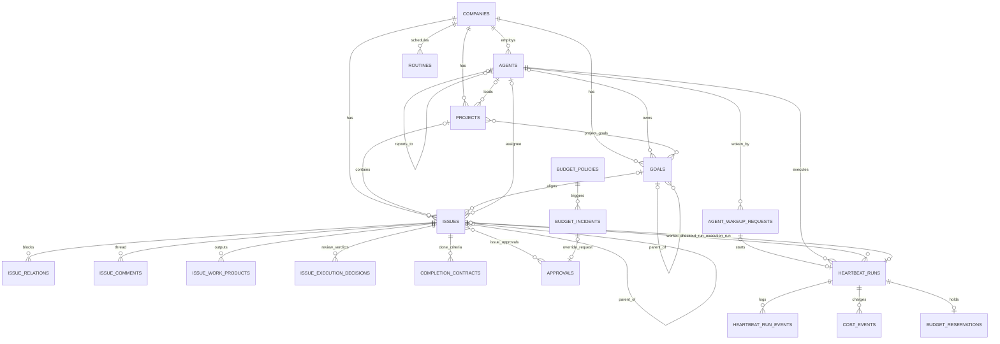

# Paperclip — research report

| Field | Value |
|---|---|
| Repo | `paperclipai/paperclip` (https://github.com/paperclipai/paperclip) |
| Local clone | `~/.hermes/profiles/datacrate360/cache/scratch/agents/paperclip` (shallow) |
| Pinned commit | `c9669a6c2237626ab0b0b2059d34c3965a86f02f` (master, 2026-10-18 07:15 -0500) |
| License | MIT, "Copyright (c) 2025 Paperclip AI" (`LICENSE:1-3`) |
| Method | Static reading only. Nothing was installed, built, run or pushed. All paths below are relative to the repo root. |
| Rubric | `omni-agent/research/RUBRIC.md` section B, T1–T14 |
| Tags | [Verified] = read in code at this commit · [Docs] = repo docs or README only · [Inference] = my conclusion from code/docs |

## Executive summary

1. Paperclip is a **control plane for "AI-agent companies"**: a Node 24 / Express 5 / Drizzle / PostgreSQL server with a React board UI. It holds companies, an org chart of agents, goals, projects, issues, budgets and approvals. It does **not** contain an agent loop of its own. It *wakes* external agent runtimes through adapters (`AGENTS.md:7`, `doc/PRODUCT.md:42-50`).
2. The core loop is **wake → queue → claim → checkout → budget reservation → adapter.execute → settle (cost, liveness, comment) → release lock → maybe wake the next agent**. That loop lives in `server/src/services/heartbeat.ts` (4,154 lines) and `server/src/services/heartbeat/*` (queue alone is 4,719 lines).
3. **Built-in adapters (16):** Claude Code, Codex, Cursor (local and cloud), Gemini, Grok, Kimi, OpenCode, Pi, ACPX, Hermes (local CLI and gateway), OpenClaw gateway, `paperclip_runner` (native Rust runner), plus generic `process` and `http` (`server/src/adapters/registry.ts:903-925`). Local CLIs are spawned as child processes. OpenClaw is driven over WebSocket RPC. Hermes gateway is driven over HTTP `POST /v1/runs` with an SSE stream.
4. **The work model is Kanban, not Scrum.** Issues use `backlog → todo → in_progress → in_review → done` plus `blocked` and `cancelled`. Issues have a single assignee, an atomic checkout lock, parent/child links, and `blocks` relations. Review/approval stages live in a per-issue `executionPolicy`. There are **no sprints, story points, estimates, velocity, WIP limits per column, or retrospectives** anywhere in the schema (grep returned nothing).
5. **Governance is real and enforced in code.** Budget policies (company/agent/project, monthly or lifetime) have a soft warning threshold and a hard stop. A hard stop **pauses the scope, cancels its work, and opens a `budget_override_required` approval** (`server/src/services/budgets.ts:408-476, 810-835`). A pre-dispatch **budget reservation** blocks runs before any money is spent (`server/src/services/budget-reservations.ts:11-67`).
6. **Agents talk back over REST or MCP.** The agent receives `PAPERCLIP_API_KEY` (a short-lived local JWT) and `PAPERCLIP_RUN_ID`, and follows the `skills/paperclip/SKILL.md` "heartbeat procedure": checkout, work, comment, then PATCH status. The same API is wrapped as ~40 MCP tools (`packages/mcp-server/src/tools.ts:291-678`).
7. **Scale and maturity:** ~10.7k files, ~2.0M lines of TS, ~555k TSX, ~80k Rust, 294 `pgTable` definitions in 170 schema files, ~350 migrations, 2,868 test files, 23 CI workflows. It is very large and moves very fast. The heartbeat code carries many recovery and edge-case branches.
8. **Verdict for omni-agent:** Paperclip is the best existing **Plan/Track/Govern** layer of the building blocks. But it is too big and too opinionated to fork-and-own. Recommended path: **depend on it as an optional external service through its REST/MCP API** in the near term, and **port its key invariants** (single assignee, atomic checkout, wake queue with coalescing, budget reservation + hard stop, review stages, run-event log) into omni-agent's own thin work layer. Add the Scrum pieces Paperclip lacks.

---

## T1 — Identity

In plain words: Paperclip is an open-source app for running a "company" whose employees are AI agents. It is MIT-licensed, written in TypeScript with a PostgreSQL database, and it is very large. There is a hosted Paperclip Cloud product (waitlist).

- Tagline: "Paperclip is the app people use to manage AI agents for work … If OpenClaw is an _employee_, Paperclip is the _company_." `README.md:38-44` [Verified]
- Self-definition for contributors: "Paperclip is a control plane for AI-agent companies." V1 build contract is `doc/SPEC-implementation.md` (2,308 lines). `AGENTS.md:7-8` [Verified]
- Long-term vision text: "backbone of the autonomous economy … rival the GDP of the world's largest countries." `doc/GOAL.md:3` [Docs]
- License: MIT, Copyright 2025 Paperclip AI. `LICENSE:1-3` [Verified]
- Stack: Express 5 (`server/package.json:98`), Drizzle ORM 0.45 (`:96`), embedded-postgres 18 (`:97`), better-auth 1.7.2 (`:89`), OpenTelemetry (`:65,129-155`), Node ≥ 24.11 (`package.json:108-109`). React + Vite UI in `ui/`. Rust native runner in `packages/paperclip-runner/runner/` (`packages/paperclip-runner/README.md:3-7`). [Verified]
- Size at this commit (find + wc, excluding node_modules): 5,930 `.ts` files / ~1.98M lines; 1,643 `.tsx` / ~555k; 67 `.rs` / ~80k; 362 `.sql`; 982 `.md` / ~207k lines. Total ~10,742 files. [Verified]
- Server package version string is `0.3.1` (`server/package.json:3`), while public releases use calendar tags like `v2026.1012.0` (from task context). [Verified]/[Docs]
- Popularity (from task context, not checked here): ~103.9k stars, 239 contributors. [Docs]
- Company / upsell: README links a "Paperclip Cloud waitlist" (`README.md:32`). `doc/DEPLOYMENT-MODES.md:6-25,88-99` describes Paperclip Cloud sign-in and a Cloud warm-pool identity. Default-on telemetry goes to `https://telemetry.paperclip.ing/ingest` (`packages/shared/src/telemetry/client.ts:15`). [Verified]
- Maturity: 2,868 test files, 23 GitHub workflows (`.github/workflows/`), strict PR template, migration safety checks (`packages/db/src/check-migration-safety.ts`). The surface is very wide (chat channels for Slack/Discord/Telegram/GitHub/voice, Skill Studio, evals, pipelines, cases, decision models). [Verified]

## T2 — Core mechanism (step by step)

In plain words: An agent never "runs forever". Something *wakes* it: a timer, a new assignment, a comment, or an approval. The server puts that wake in a queue, checks budget and permissions, locks the issue to that run, and starts the agent's CLI or HTTP endpoint with the task as a prompt. When the agent finishes, the server records cost, decides whether the run made progress, and releases the lock so the next wake can start.

### 2.1 Unit of work: goal → project → issue

- `goals` form a tree (`parent_id`) with `level ∈ {company, team, agent, task}` and an owner agent. `packages/db/src/schema/goals.ts:15-22`, `packages/shared/src/constants.ts:562-566` [Verified]
- `projects` have a primary `goal_id` plus many-to-many `project_goals`, a `lead_agent_id`, `status` (default `backlog`) and `target_date`. `packages/db/src/schema/projects.ts:13-21`, `project_goals.ts:9-16` [Verified]
- `issues` carry `project_id`, `goal_id`, `parent_id`, `status` (default `backlog`), `priority`, `work_mode ∈ {standard, ask, planning, skill_test}`, `review_policy`, single assignee (`assignee_agent_id` XOR `assignee_user_id`), and the two lock columns `checkout_run_id` / `execution_run_id`. `packages/db/src/schema/issues.ts:37-75`, `constants.ts:189-215` [Verified]
- Human-readable IDs come from `companies.issue_prefix` + `issue_counter` (e.g. `PAP-123`). `companies.ts:13-14`, `issues.ts:63-64` [Verified]

### 2.2 Wake sources

1. **Timer.** `server/src/index.ts:1221-1223` runs `setInterval(..., config.heartbeatSchedulerIntervalMs)` → `heartbeat.tickTimers()`. [Verified]
2. `tickTimers` loops over agents of active companies. It skips non-invokable agents, reads `runtimeConfig.heartbeat.{enabled, intervalSec}`, and uses a CAS update on `agents.last_heartbeat_at` (`claimDueTimerHeartbeat`) so only one server wins. Then it calls `enqueueWakeup(agent, {source:"timer", reason:"heartbeat_timer"})`. It also ticks issue monitors. `server/src/services/heartbeat/scheduling.ts:1155-1238`, `heartbeat/queue.ts:609-638` [Verified]
3. **Assignment / execution-stage change.** Issue PATCH builds a wake with `source:"assignment"` and reasons such as `execution_review_requested`, `execution_approval_requested` or `execution_changes_requested`. `server/src/routes/issues.ts:2825-2895` [Verified]
4. **Comment.** `reason:"issue_commented"` wakes the assignee. `routes/issues.ts:2648, 15723, 19060` [Verified]
5. **Approval decided.** `POST /approvals/:id/approve` wakes the requesting agent and linked issue assignees, with an idempotency key `approval-review-path:<approvalId>:<issueId>:<status>`. `server/src/routes/approvals.ts:96-125, 296, 332` [Verified]
6. **Checkout by someone else** wakes the assignee unless the agent checked out its own issue in its own run. `server/src/routes/issues-checkout-wakeup.ts:8-14` [Verified]
7. Routines (cron/webhook) create issues (`origin_kind = routine_execution`), which then wake by assignment. `packages/db/src/schema/routines.ts:37-38,112-119`, `issues.ts:149-157` [Verified]

### 2.3 Admission: `enqueueWakeup`

- Entry: `heartbeat/queue.ts:2081`. It validates the actor, idempotency keys and request-ID reuse (`:2097-2259`). [Verified]
- If the issue already has a live execution, the wake is parked as `agent_wakeup_requests.status = 'deferred_issue_execution'` and later **coalesced** (`coalesced_count + 1`) instead of starting a second run on the same issue. `queue.ts:3129-3156, 3701-3737`, schema `agent_wakeup_requests.ts:25-40`, statuses `constants.ts:907-916` [Verified]
- Company must be active (`queue.ts:2386`). **Budget gate:** `budgets.getInvocationBlock(company, agent, {projectId})` → on a block it writes a skipped request `budget.blocked` and throws 409. `queue.ts:2552-2569` [Verified]
- **Invokability gate:** the agent must be invokable (status, lifecycle, valid org chain). `queue.ts:2571-2583` [Verified]
- Then it inserts a `heartbeat_runs` row with `status='queued'` (`queue.ts:4073`) and calls `startNextQueuedRunForAgent` (`:4173-4196`). [Verified]

### 2.4 Dispatch: `startNextQueuedRunForAgent`

- Takes a per-agent start lock, rechecks invokability, computes `availableSlots = maxConcurrentRuns − running`. Default concurrency is 20 per agent, clamped to 1..50. `queue.ts:1896-1925, 213-217, 244-253`; `constants.ts:77` [Verified]
- Optional daily caps per agent: `maxDailyRuns`, `maxDailyCostCents` (from `runtimeConfig.heartbeat`). `queue.ts:394-427, 460-575` [Verified]
- Queued runs are ordered by issue priority rank and dependency readiness. Runs whose blockers are unresolved are cancelled or deferred. `queue.ts:640-676, 1685-1742` [Verified]

### 2.5 Execution: `executeRunAttempt` (heartbeat.ts)

1. `claimQueuedRun(run)` moves queued → running atomically and binds the issue execution claim. `heartbeat.ts:1839`, `queue.ts:939-1181` [Verified]
2. Load agent and runtime state (`agent_runtime_state`: session id, token totals). `heartbeat.ts:1993, 2041`; schema `agent_runtime_state.ts:8-19` [Verified]
3. **Atomic issue checkout** for the run: `issuesSvc.checkout(...)` (`heartbeat.ts:2136, 2173`). The service does a single conditional `UPDATE issues SET assignee_agent_id, checkout_run_id, execution_run_id, status='in_progress' WHERE status IN (expected) AND (assignee is null OR same agent/run) AND execution lock is free`. `server/src/services/issues.ts:11657-11800` (update at `:11743-11756`) [Verified]
4. Resolve the responsible human, trust preset, AI connection / pool account, and ledger scope (project/goal/issue for cost attribution). `heartbeat.ts:2338-2611` [Verified]
5. Build task context and prompt markdown (`prepareHeartbeatTaskContext`). `heartbeat.ts:2617`; modules `heartbeat/task-context.ts`, `task-markdown.ts` [Verified]
6. **Budget reservation** inside an accounting transaction: lock the run row; re-run `getInvocationBlock`; for every hard-stop policy check `observed + held reservations + this reservation ≤ limit`; insert a `budget_reservations` row; set `cost_accounting_pending=true`. `heartbeat.ts:2883-2885` → `server/src/services/budget-reservations.ts:11-67` [Verified]
7. Prepare the workspace (project workspace / git worktree / SSH / sandbox environment lease) and runtime services such as preview servers. `heartbeat.ts:3245-3250`, `heartbeat/workspace-preparation.ts`, `environment-selection.ts` [Verified]
8. `adapter = getServerAdapter(agent.adapterType)` (`heartbeat.ts:3252`). Native vs. legacy runtime is resolved and then stays fixed for that run (`:3275-3297`). `selectHeartbeatRuntime` (`:3300`) → `executeHeartbeatRuntime` → `adapter.execute({...})` at `heartbeat/runtime-execution.ts:796`. [Verified]
9. Streaming: the adapter calls `onLog(stream, chunk)`, `onMeta`, `onEvent` and `onUsage`. The server appends rows to `heartbeat_run_events (run_id, seq, event_type, stream, level, message, payload)` with a unique `(run_id, seq)`. `packages/adapter-utils/src/types.ts:272-276`, `packages/db/src/schema/heartbeat_run_events.ts:18-46` [Verified]
10. **Completion** `runCompletion.completeRun(...)` (`heartbeat.ts:3512`): set the terminal status, run `accountRunCost` (turns usage receipts into `cost_events`, releases the reservation, then `budgets.evaluateCostEvent`), and classify **liveness** (`completed | advanced | plan_only | empty_response | blocked | failed | needs_followup`). It also updates the wake request and appends lifecycle events. `server/src/services/heartbeat/run-completion.ts:381, 640-700`; `run-cost-accounting.ts:19-40`; `costs.ts:139-155`; `constants.ts:931-939` [Verified]
11. The run must leave an issue comment: `heartbeat_runs.issue_comment_status` and `issue_comment_satisfied_by_comment_id` track this. An `issue_comment_retry_queued_at` column shows that a retry is queued when no comment exists. `heartbeat_runs.ts:101-103` [Verified columns; retry behavior = Inference]
12. Release: compare-and-clear lock columns that still point at this run, then promote the next deferred wake (`releaseIssueExecutionAndPromote`). `heartbeat.ts:1399`; rules in `doc/execution-semantics.md:191-205` [Verified]/[Docs]

### 2.6 What the agent does inside the run (agent-side protocol)

- The agent reads `PAPERCLIP_RUN_ID`, `PAPERCLIP_TASK_ID`, `PAPERCLIP_WAKE_REASON`, `PAPERCLIP_WAKE_COMMENT_ID`, `PAPERCLIP_APPROVAL_ID`/`_STATUS` and `PAPERCLIP_API_KEY` from its environment. `packages/adapters/claude-local/src/server/execute.ts:223-311` [Verified]
- It follows `skills/paperclip/SKILL.md` "The Heartbeat Procedure": identity → approval follow-up → pick work → **`POST /api/issues/{id}/checkout`** with header `X-Paperclip-Run-Id` → read context → do the work → comment → `PATCH /api/issues/{id}` with status → create subtasks with `parentId`/`goalId` if delegating. `skills/paperclip/SKILL.md:30, 89-123, 269` [Verified]
- Reviewers approve with `PATCH {status:"done"}` or request changes with `PATCH {status:"in_progress"}`. The server turns this into a stage decision and reassigns. `SKILL.md:146-153` [Verified]

## T3 — Architecture and process model

In plain words: There is one Node server process that serves the REST API, the UI and the background schedulers. Agent runtimes run as child processes, as remote HTTP/WebSocket services, or under a separate Rust "native runner". Plugins run as their own child processes and talk JSON-RPC over stdio.

- Repo map: `server/` (Express API + orchestration), `ui/` (React/Vite board), `packages/db` (Drizzle schema + migrations), `packages/shared` (types/constants/validators), `packages/adapters/*`, `packages/adapter-utils`, `packages/plugins/*`, `cli/` (`paperclipai` bin), `skills/` (runtime skills given to agents). `AGENTS.md:46-59` [Verified]
- In-process background loops in `server/src/index.ts`: heartbeat scheduler (`:1221`), execution-control sweep (`:1217`), skill-source sync every 5 s (`:1233`), skill version retention (`:1265`). [Verified]
- Heartbeat is split into a coordinator plus modules (queue, scheduling, run-preparation, session-preparation, workspaces, runtime-selection, runtime-execution, run-completion, run-control, retries, recovery, task-context, run-log). The scoped rule `rules/heartbeat-execution-boundaries.mdc` requires "Execution requires current authority" and says "Keep the coordinator from growing back". `rules/heartbeat-execution-boundaries.mdc:1-80` [Verified]
- Service layer: 769 files in `server/src/services/`. Route layer: ~95 route modules. `routes/issues.ts` alone is 19,645 lines with 100 handlers; `services/issues.ts` is 13,708 lines. [Verified]
- Plugins: "One worker process per installed plugin … JSON-RPC 2.0 over stdio … crash isolation … exponential-backoff restart". `server/src/services/plugin-worker-manager.ts:1-15` [Verified]
- Native runner: Rust production runner + TS reference, "PRP v1" protocol, durable WebSocket delivery, drivers for Codex, OpenCode, ACPX, Claude Managed and AWS AgentCore. Local runners connect to Core over loopback WS; SSH/sandbox runners over WSS. `packages/paperclip-runner/README.md:1-31` [Docs]
- Realtime to the UI: live event types `heartbeat.run.queued/status/progress…`. `packages/shared/src/constants.ts:942-945`, `server/src/realtime/` [Verified]
- Database: embedded PostgreSQL when `DATABASE_URL` is unset (`doc/DATABASE.md:103-105, 319`). Note: `AGENTS.md:63` still says "embedded PGlite". The docs disagree; `packages/db/src/runtime-config.ts` mentions both. [Verified — doc drift]

## T4 — Data model (schema)

In plain words: Everything lives in PostgreSQL tables defined with Drizzle in `packages/db/src/schema/`. Every business row carries a `company_id`, which is how one install serves many organizations. The core tables are companies, agents, goals, projects, issues, runs, run events, costs, budgets and approvals.

- 170 schema files, 294 `pgTable(...)` calls, ~350 migration files. `packages/db/src/schema/`, `packages/db/src/migrations/` [Verified]
- Rule: "Every domain entity should be scoped to a company and company boundaries must be enforced in routes/services." `AGENTS.md:91-92` [Verified]

| Table | Key columns (file:line) | Agile meaning |
|---|---|---|
| `companies` | `issue_prefix`, `issue_counter`, `budget_monthly_cents`, `spent_monthly_cents`, `status/pause_reason`, `require_board_approval_for_new_agents` (`companies.ts:7-31`) | Tenant / organization / product line |
| `agents` | `role` (ceo, cto, cmo, cfo, security, engineer, designer, pm, qa, devops, researcher, general), `reports_to` (self-FK = org chart), `adapter_type`, `adapter_config`, `runtime_config`, `budget_monthly_cents`, `status`, `permissions`, `last_heartbeat_at` (`agents.ts:20-49`; roles `constants.ts:46-59`) | Team member |
| `goals` | `level`, `status ∈ {planned, active, achieved, cancelled}`, `parent_id`, `owner_agent_id` (`goals.ts:15-22`) | Product goal / OKR / epic tree |
| `projects` + `project_goals` | `goal_id`, `lead_agent_id`, `status ∈ {backlog, planned, in_progress, completed, cancelled}`, `target_date`, `execution_workspace_policy` (`projects.ts:11-30`; `constants.ts:568-574`) | Epic / release / repo |
| `issues` | see T2.1; plus `execution_policy`, `execution_state`, `monitor_*`, `billing_code`, `origin_kind`, `request_depth` (`issues.ts:29-98`) | Story / task / bug |
| `issue_relations` | `type` is only `"blocks"` (`issue_relations.ts:13`) | Dependency |
| `issue_comments` | `author_agent_id/user_id`, `created_by_run_id`, `body` (`issue_comments.ts:18-47`) | Discussion / evidence |
| `issue_documents`, `documents`, `document_revisions` | issue `plan` document etc. | Spec / plan |
| `issue_work_products` | `type`, `provider`, `url`, `review_state`, `is_primary`, `created_by_run_id` (`issue_work_products.ts:21-43`) | Increment / PR / artifact |
| `issue_execution_decisions` | `stage_id`, `stage_type`, `outcome ∈ {approved, changes_requested}`, `actor_*`, `created_by_run_id` (`issue_execution_decisions.ts:9-21`; `constants.ts:559`) | Review verdict |
| `completion_contracts` | `risk`, `completion_authority`, `incomplete_criteria_policy`, `contract_json`, `canonical_sha256`, revisioned (`completion_contracts.ts:17-32`) | Definition of Done / acceptance criteria |
| `approvals` + `issue_approvals` | `type ∈ {hire_agent, approve_ceo_strategy, budget_override_required, request_board_approval}`, `status ∈ {pending, revision_requested, approved, rejected, cancelled}` (`approvals.ts:8-19`; `constants.ts:689-703`) | Governance gate |
| `agent_wakeup_requests` | `source`, `reason`, `payload`, `status`, `coalesced_count`, `idempotency_key`, `run_id` (`agent_wakeup_requests.ts:18-46`) | Pull signal |
| `heartbeat_runs` | `agent_id`, `issue_id`, `invocation_source ∈ {timer, assignment, on_demand, automation}`, `status ∈ {queued, scheduled_retry, running, succeeded, interrupted, failed, cancelled, timed_out}`, `usage_json`, `result_json`, `session_id_before/after`, `process_pid`, `retry_of_run_id`, `liveness_state`, `context_snapshot`, log pointers (`heartbeat_runs.ts:25-111`; `constants.ts:896-929`) | One unit of agent effort |
| `heartbeat_run_events` | `run_id`, `seq`, `event_type`, `stream`, `level`, `message`, `payload` (`heartbeat_run_events.ts:21-37`) | Execution trace |
| `cost_events` | `agent_id`, `issue_id`, `project_id`, `goal_id`, `heartbeat_run_id`, `provider`, `model`, token counts, `cost_cents`, `billing_type`, `cost_status`, `idempotency_key` (`cost_events.ts:14-40`) | Cost ledger |
| `budget_policies` | `scope_type ∈ {company, agent, project}`, `window_kind ∈ {calendar_month_utc, lifetime}`, `amount`, `warn_percent` (80), `hard_stop_enabled` (true), `unpriced_usage_policy` ("block"), `reservation_cents` (`budget_policies.ts:8-22`; `constants.ts:875-882`) | Capacity / spend limit |
| `budget_incidents` | `threshold_type ∈ {soft, hard}`, `amount_observed`, `approval_id`, `status` (`budget_incidents.ts:10-26`) | Impediment |
| `budget_reservations` | pre-dispatch hold per run (`accounting.ts:52`) | Committed capacity |
| `routines` (+ triggers) | `concurrency_policy` ("coalesce_if_active"), `catch_up_policy` ("skip_missed"), `cron_expression`, `timezone` (`routines.ts:26-45,112-119`) | Recurring ceremony / chore |
| `work_assessments` | `trigger_kind`, `prior_issue_status`, `assessment_json`, `policy_version` (`work_assessments.ts:27-39`) | Automated work review (closest to inspection) |
| `agent_runtime_state`, `agent_task_sessions` | session id/params, token and cost totals (`agent_runtime_state.ts:8-19`) | Agent memory of a task |
| `activity_log` | audit of all mutations (`AGENTS.md:111`) | Audit trail |



## T5 — Interfaces

In plain words: You can drive Paperclip through a REST API under `/api`, an MCP server, the `paperclipai` CLI, the web UI, and plugins. Agents use the same REST API with a bearer key, and every write carries the run ID header.

- **REST**: base path `/api`. Board (human) access is full control. Agents use bearer API keys (`agent_api_keys`, hashed) or a run-scoped local JWT. Required error codes: 400/401/403/404/409/422/500. `AGENTS.md:217-229` [Verified]
- **Hot agent routes**: `POST /api/issues/:id/checkout` (`server/src/routes/issues.ts:15907`), `POST /api/issues/:id/release` (`:16060`), `PATCH /api/issues/:id` (`:13573`), `POST /api/companies/:companyId/issues` (`:12156`), `POST /api/issues/:id/comments` (`:18170`), `GET|POST /api/issues/:id/interactions` (`:16695`). Full table at `skills/paperclip/SKILL.md:703-720`. [Verified]
- **Approvals**: `GET/POST /companies/:companyId/approvals`, `POST /approvals/:id/{approve,reject,resubmit,comments}`. `server/src/routes/approvals.ts:215-517` [Verified]
- **Issue-thread interactions** (human-in-the-loop cards): `suggest_tasks`, `ask_user_questions`, `request_confirmation`, `request_checkbox_confirmation`, `request_item_verdicts`, `connection_intent`. `packages/shared/src/constants.ts:259-266` [Verified]
- **MCP**: package `@paperclipai/mcp-server`, bin `paperclip-mcp-server` (stdio) (`packages/mcp-server/package.json:2,16`). Tools include `paperclipMe`, `paperclipInboxLite`, `paperclipListIssues`, `paperclipGetIssue`, `paperclipGetHeartbeatContext`, `paperclipCheckoutIssue`, `paperclipReleaseIssue`, `paperclipUpdateIssue`, `paperclipCreateIssue`, `paperclipAddComment`, `paperclipSuggestTasks`, `paperclipAskUserQuestions`, `paperclipRequestConfirmation`, `paperclipUpsertIssueDocument`, `paperclipCreateApproval`, `paperclipApprovalDecision`, `paperclipListGoals`, `paperclipListProjects`, `paperclipApiRequest` (generic escape hatch). `packages/mcp-server/src/tools.ts:291-678` [Verified]
- **CLI**: bin `paperclipai` (`cli/package.json:6-7`). Commands: `onboard`, `install`, `configure`, `doctor`, `run`, `heartbeat-run`, `routines`, `pipelines`, `worktree`, `mcp`, `db-backup`, `channels`, `managed-agent`, `env`, `update`, `uninstall` and more. `cli/src/commands/` [Verified]
- **Adapter API** (TS): `ServerAdapterModule { type; execute(ctx); testEnvironment(ctx); sessionCodec?; listSkills?/syncSkills?; listModels?; onHireApproved?; getQuotaWindows?; getConfigSchema?; supportsInstructionsBundle?; getRuntimeCommandSpec?; loginCapability? }`. `packages/adapter-utils/src/types.ts:504-598` [Verified]
- **Plugin API**: SDK `packages/plugins/sdk` (`define-plugin.ts`, `protocol.ts`, `worker-rpc-host.ts`), scaffold `create-paperclip-plugin`, capability allowlist with ~80 entries (`issues.read`, `issues.create`, `issues.checkout`, `issues.wakeup`, `agents.invoke`, `approvals.respond`, `routines.managed`, `database.namespace.migrate`, `telemetry.track`, …). `packages/shared/src/constants.ts:1322-1400`, `doc/plugins/PLUGIN_SPEC.md` [Verified]
- **Skills shipped to agents**: `skills/paperclip`, `paperclip-board`, `paperclip-converting-plans-to-tasks`, `paperclip-create-agent`, `para-memory-files`, `agentmail`, `slack`, `complain`, `suggestion-box`. `skills/` [Verified]

## T6 — How it plugs into agents

In plain words: Paperclip is the boss and the agents are workers. For local coding agents it launches the CLI in non-interactive mode with the task as the prompt and reads the streamed JSON output. For remote agents it calls their HTTP or WebSocket API. In both cases the agent reports back by calling Paperclip's API.

| Adapter type | Mechanism | Evidence |
|---|---|---|
| `claude_local` | spawns `claude --print --output-format stream-json --verbose [--resume <session>] [--model] [--effort] [--max-turns] [--append-system-prompt-file] [--mcp-config … --strict-mcp-config] --add-dir <bundle>`; `dangerouslySkipPermissions` defaults to **true**; an ACP engine path also exists | `packages/adapters/claude-local/src/server/execute.ts:419, 440, 850-880` [Verified] |
| `codex_local` | `codex exec --json`, default `sandbox_mode="workspace-write"` unless a bypass is configured (`--dangerously-bypass-approvals-and-sandbox`) | `packages/adapters/codex-local/src/server/codex-args.ts:46-62` [Verified] |
| `hermes_local` | spawns `hermes chat -q "<prompt>" -Q [-m] [--provider] [-t toolsets] [--max-turns] [-w] [--checkpoints] --source tool --yolo [--resume <id>]` via `runChildProcess` | `packages/adapters/hermes/src/server/execute.ts:1-19, 458-496, 585` [Verified] |
| `hermes_gateway` | HTTP `POST {baseUrl}/v1/runs` with auth + idempotency + session headers, then SSE `GET /v1/runs/:id/events`, status poll, `POST /v1/runs/:id/stop` | `packages/adapters/hermes/src/gateway/server/execute.ts:620-1006`; re-exported by `packages/adapters/hermes-gateway/src/server/index.ts:1-9` [Verified] |
| `openclaw_gateway` | WebSocket client to the OpenClaw gateway; device-key pairing (`device.pair.*`), `connect.challenge`, RPC `agent` then `agent.wait`; session key prefixed `agent:<id>:` | `packages/adapters/openclaw-gateway/src/server/execute.ts:21, 142-145, 649-789, 1334, 1364` [Verified] |
| `process` | generic command via `runChildProcess` | `server/src/adapters/process/execute.ts:17-30` [Verified] |
| `http` | fire-and-forget POST `{agentId, runId, context, …payloadTemplate}`; success = 2xx; the agent later calls back via REST | `server/src/adapters/http/execute.ts:5-50` [Verified] |
| `paperclip_runner` | native Rust runner over the PRP WebSocket protocol; required for durable "goal control" runs | `heartbeat.ts:3253-3266`; `packages/paperclip-runner/README.md` [Verified]/[Docs] |
| others | `cursor`, `cursor_cloud`, `gemini_local`, `grok_local`, `kimi_local`, `opencode_local`, `pi_local`, `acpx_local` | `server/src/adapters/registry.ts:903-925`; `constants.ts:27-43` [Verified] |

- External adapters: `registerServerAdapter()` / `getServerAdapter()` (`registry.ts:1012, 1046`). External packages export `createServerAdapter()` and are loaded from an adapter plugin store (`server/src/adapters/plugin-loader.ts:1-25`, `registry.ts:927-940`). Input validation accepts any non-empty adapter string, and the server checks registration (`adapter-plugin.md:1-60`). [Verified]
- Session continuity: adapters return `sessionId`/`sessionParams`; Paperclip stores them per agent and task (`agent_task_sessions`, `heartbeat_runs.session_id_before/after`) and passes `--resume` on the next wake. `types.ts:132-134`, `heartbeat_runs.ts:72-73` [Verified]
- Context injection: prompt template + task markdown + env vars + an optional strict MCP config that gives the agent Paperclip tools. `claude-local/src/server/execute.ts:223-311, 434-435, 793, 878` [Verified]
- Interop note for this user: the Hermes adapter targets the same `hermes` CLI flags that this Hermes install uses. A Paperclip agent could be a Hermes profile. [Inference]

## T7 — LLM usage

In plain words: Most model calls happen *inside* the agents that Paperclip launches, so the agents' own subscriptions or API keys pay for them. Paperclip itself calls models only for a few optional features. Because it needs agents to do anything useful, it does not do real work offline, although the server and DB run locally.

- Main cost driver = agent runs. Adapters report `usage`, `usageByModel`, `costUsd`, `billingType`, `costStatus ∈ {reported, estimated, unpriced}` and `pricingProvenance`. `packages/adapter-utils/src/types.ts:118-151` [Verified]
- Paperclip ingests those numbers into `cost_events` with idempotency/receipt hashes (`server/src/services/costs.ts:139`). It keeps its own price tables, e.g. `server/src/services/anthropic-pricing.ts`, and does billing reconciliation (`billing-reconciliation.ts:169`). [Verified]
- Direct server-side LLM features (all optional or experimental):
  - "Company fast responses", which acknowledge a human turn through the Vercel AI SDK (OpenAI, Anthropic, Google, xAI, OpenRouter, Bedrock). `doc/fast-responses.md:1-8` [Docs]
  - "Decision models" for background decisions. `doc/decision-models.md:1-10` [Docs]
  - Provider HTTP calls appear in `server/src/services/ai-connection-usage.ts`, `subscription-identity.ts` and `provider-billing-import.ts`. [Verified file list; purpose = Inference]
- Token efficiency: Claude resumes skip re-injecting instructions ("wastes 5-10K tokens per heartbeat"). `claude-local/src/server/execute.ts:871-876` [Verified]
- Offline: the server, UI and embedded Postgres run locally (`AGENTS.md:61-80`). Agents need whatever their CLI needs. Telemetry is opt-out (`PAPERCLIP_TELEMETRY_DISABLED=1` or `DO_NOT_TRACK=1`, `packages/shared/src/telemetry/config.ts:71-74`). [Verified]

## T8 — Security, privacy, safety, legal

In plain words: Paperclip has serious access control: company scoping, agent keys, private issues, scoped secrets, plugin capabilities and approval gates. But by default it launches coding agents with their own safety prompts **turned off**, because there is no human at a terminal to answer them. That is a big trust decision omni-agent must make on purpose.

- **Permission bypass defaults**: Claude `dangerouslySkipPermissions` defaults to `true` (`claude-local/src/server/execute.ts:440`). Hermes is always started with `--yolo`, with the comment "Agents operate in a sandbox — the approval system is designed for human-attended interactive sessions" (`hermes/src/server/execute.ts:486-492`). Codex defaults to `workspace-write` sandbox unless bypass is set (`codex-args.ts:46-61`). [Verified]
- **Tenant isolation**: company scoping rule plus "agent keys must not access other companies" (`AGENTS.md:91-92, 221-222`). Composite FKs such as `(company_id, issue_id)` (`completion_contracts.ts:40-44`). [Verified]
- **Agent auth**: hashed `agent_api_keys`; run-scoped HMAC local JWT (`server/src/agent-auth-jwt.ts:1-25`), injected as `PAPERCLIP_API_KEY` (`claude-local/src/server/execute.ts:302-311`). [Verified]
- **Issue privacy**: `visibility ∈ {open, private}` with privacy root/parent columns (`issues.ts:41-43, 101`). `PAPERCLIP_ISSUE_PRIVACY_MODE=enforce` is the default (`doc/ISSUE-PRIVACY.md:130`). [Verified]/[Docs]
- **Secrets**: company secrets with versions, bindings and proposals (`company_secrets.ts`, `company_secret_proposals.ts`). The agent skill says to propose credentials via `POST /api/agents/me/secret-proposals` and never paste them into comments (`skills/paperclip/SKILL.md:562-569`). Log redaction exists (`server/src/log-redaction.ts`, `redaction.ts`). [Verified]
- **Deployment modes**: `local_trusted` (no login), `authenticated+private`, `authenticated+public`. Public mode fails closed for local stdio MCP runtimes. `doc/DEPLOYMENT-MODES.md:31-86` [Docs]
- **Plugin sandboxing**: out-of-process workers with a capability allowlist. Impersonation-style capabilities (`issue.interactions.respond`, `approvals.respond`) re-verify that the human is a member at apply time. `plugin-worker-manager.ts:1-15`; `constants.ts:1322-1400` [Verified]
- **Telemetry** is opt-out and sends to a Paperclip endpoint by default. AGENTS.md requires a privacy review for telemetry changes. `AGENTS.md:125-146`; `telemetry/client.ts:15` [Verified]
- **HTTP adapter SSRF guard**: `guardedHttpAdapterFetch`. `server/src/adapters/http/execute.ts:3, 30` [Verified name; behavior not read]
- **Legal**: MIT, so it is compatible with an MIT omni-agent. Keep the copyright notice when copying code. Logos and the "Paperclip" brand are not covered by MIT. [Inference]

## T9 — Quality

In plain words: The project has a huge test suite and many CI pipelines, including evals and chaos tests for the runner. I did not run any of them. There is no benchmark claim in the README to re-check.

- 2,868 test files (`*.test.ts(x)`, `*.spec.ts`). Default `pnpm test` = Vitest only; Playwright e2e and release smoke are opt-in. `AGENTS.md:190-213` [Verified]
- 23 workflows, including `pr.yml`, `e2e.yml`, `release-smoke.yml`, `runner-chaos-evals.yml`, `runner-live-evals.yml`, `runner-protocol-live-evals.yml`, `storybook-visual.yml`, `commitperclip-review.yml` (bot PR review), `cloud-readiness.yml`. `.github/workflows/` [Verified]
- DB safety: migration numbering and safety checkers, snapshot drift test. `packages/db/src/check-migration-numbering.ts`, `check-migration-safety.ts`, `migration-snapshot-drift.test.ts` [Verified]
- Evals: promptfoo evals in `evals/promptfoo`; `.agents/skills/paperclip-evals`, `terminal-bench-loop`. [Verified paths]
- UI token gate: `pnpm check:token-gates` (`scripts/check-token-gates.mjs`). `AGENTS.md:261` [Verified]
- Not verified: pass rates, coverage, flakiness. The README does not claim benchmark numbers. [Verified absence in README head]

## T10 — Operations

In plain words: Install with pnpm and run `pnpm dev`, or use the Docker image. You get the API and UI on port 3100 and an embedded Postgres automatically. It needs Node 24 and a lot of disk for dependencies.

- Dev: `pnpm install && pnpm dev` → API + UI at `http://localhost:3100`; health at `/api/health`. `AGENTS.md:61-80` [Verified]
- DB: embedded PostgreSQL under `~/.paperclip/instances/default/db/` unless `DATABASE_URL` is set. `doc/DATABASE.md:103-105, 319` [Docs]
- Docker: `Dockerfile`, `docker/`, `doc/DOCKER.md`; the image uses embedded Postgres by default (persist `/paperclip`). `doc/DATABASE.md:153` [Docs]
- Exposure modes and Tailscale broker package (`packages/tailscale-https-broker`). [Verified path]
- Observability ops: OTLP traces only when `OTEL_EXPORTER_OTLP_ENDPOINT` is set (grpc / http-protobuf / http-json). Sentry error monitoring. `server/src/instrumentation.ts:1-15`; `doc/observability.md:93, 508` [Verified]
- Footprint: very large monorepo (pnpm workspaces; `pnpm-lock.yaml`). The Rust runner needs a Rust toolchain (`packages/paperclip-runner/rust-toolchain.toml`). [Verified paths; install size not measured]
- Backup: `paperclipai db-backup`, instance DB backups route. `cli/src/commands/db-backup.ts`; `server/src/routes/instance-database-backups.ts` [Verified paths]

## T11 — New vs. marketing

In plain words: The core claims are backed by real code: org chart, goals, heartbeats, budgets with hard stops, and approvals. A few phrases are larger than the code. "Performance reviews for agents" and "training" are partly experimental, and the "autonomous economy / GDP of nations" vision is marketing.

| Claim | Check | Verdict |
|---|---|---|
| "If it can receive a heartbeat, it's hired" (`README.md:76`) | 16 built-in adapters + generic `http`/`process` + external adapter plugins (`registry.ts:903-940`) | True [Verified] |
| Budgets with hard stop (`README.md:134-136, 296`) | soft/hard incidents, pause + cancel, override approval, pre-dispatch reservation (`budgets.ts:283-315, 408-476, 773-835`; `budget-reservations.ts`) | True. The README itself warns that "usage reporting and in-flight work can delay a stop" (`README.md:296`) [Verified] |
| Goal alignment ("agents receive the goal context") | `goal_id` on issues/projects, goal tree; goal fallback service `issue-goal-fallback.ts` | Structurally true; how much goal text reaches the prompt was not traced [Verified/Inference] |
| Multi-organization (`README.md:138`) | `company_id` everywhere, composite FKs | True [Verified] |
| Governance / approvals | 4 approval types + issue execution stages + interactions | True, but approval *types* are narrow (hire, CEO strategy, budget override, generic board) [Verified] |
| "Performance reviews for agents", "active learning loops" (`README.md` pillars table) | `work_assessments`, `issue_productivity_review` origin (`issues.ts:190-197`), feedback votes, evals | Partial; no agent scorecard model found [Inference] |
| "Atomic issue checkout" (`AGENTS.md:108`) | single conditional UPDATE (`issues.ts` service `:11743-11756`) | True [Verified] |
| "Org chart" | `agents.reports_to` + invokability checks "invalidOrgChain" (`queue.ts:2581`) | True [Verified] |
| Autonomous economy / GDP of nations (`doc/GOAL.md:3`) | — | Marketing [Docs] |

Genuinely new ideas worth copying: (a) **wake queue with coalescing and per-issue deferral**, so there is never more than one live run per issue; (b) **budget reservation before provider dispatch** plus hard-stop auto-pause; (c) **run liveness classification** (`plan_only`, `empty_response`), which catches agents that only talk; (d) **mandatory run comment** tracking; (e) **completion contracts** with hashed, revisioned acceptance criteria; (f) **"Thinking Path" + "Model Used"** PR template for AI-authored code. [Inference based on Verified code]

## T12 — Weaknesses, limits, risks

In plain words: It is huge, complex and changes daily, so forking it means owning millions of lines. It does Kanban-style task flow and governance but not Scrum. Safety by default relies on sandboxes the user may not have.

- **Complexity / churn**: `routes/issues.ts` 19,645 lines, `services/issues.ts` 13,708, `heartbeat/queue.ts` 4,719, `heartbeat.ts` 4,154. A large share of code is recovery for crashed runs, stale locks, native restart and chat channels. `doc/execution-semantics.md` is 1,865 lines of invariants. A fork would drift quickly. [Verified sizes; Inference on drift]
- **Scope creep**: Slack/Discord/Telegram/GitHub/voice chat channels, iMessage, Grok bot, browser-use, pipelines, cases, Skill Studio and decision models all ship in core, even though `doc/PRODUCT.md:187-206` says "thin core, rich edges". [Verified]
- **No Scrum primitives**: no sprint/iteration, estimate/points, velocity, column WIP limits, sprint goal, retrospective or burndown (grep over schema and constants returned nothing). Only agent run concurrency (`maxConcurrentRuns`, default 20) and daily caps exist. [Verified]
- **Single assignee by design** (`doc/execution-semantics.md:22-30`). Pairing or mob work must be modelled as subtasks or review stages. [Verified]
- **Dependency model is thin**: `issue_relations.type` is only `"blocks"` (`issue_relations.ts:13`). [Verified]
- **Approval stages are 1-of-N**: `approvalsNeeded: 1` is typed as the literal `1` (`packages/shared/src/types/issue.ts:712-717`). No quorum. [Verified]
- **Unsafe defaults** for local coding agents (T8). [Verified]
- **Budget enforcement depends on reported usage**: subscription-billed CLIs may report no prices. `unpriced_usage_policy` defaults to "block" (`budget_policies.ts:18`), which can stop work unexpectedly. [Verified + Inference]
- **Doc drift**: PGlite vs embedded Postgres (`AGENTS.md:63` vs `doc/DATABASE.md:103`); `adapter-plugin.md` at the root is a pasted chat/branch note, not a spec. [Verified]
- **Vendor direction**: Cloud waitlist and default-on telemetry mean future features may move to Cloud. [Inference]
- **Node 24+ requirement** and heavy dependencies. [Verified]

## T13 — How it fits into omni-agent

In plain words: Paperclip is the closest thing to omni-agent's **Plan + coordination + governance** layer. It knows who works on what, why, at what cost, and who must approve. It is too large to fork and own, so omni-agent should talk to it over its API at first and copy its best rules into a small work layer of its own. Then omni-agent adds sprints, estimates, WIP limits and retros on top.

### 13.1 Paperclip concept → Scrum/Kanban concept

| Paperclip | Scrum / Kanban | Notes / evidence |
|---|---|---|
| Company | Organization / product | `companies` |
| Goal tree (`company→team→agent→task`) | Product goal → epics / OKRs | `goals.ts:19-21` |
| Project (+ target date, lead) | Epic or release | `projects.ts:13-21` |
| Issue | User story / task / bug | `issues.ts` |
| Sub-issue (`parent_id`) | Story → task breakdown | `issues.ts:40` |
| `blocks` relation | Dependency / impediment | `issue_relations.ts:13` |
| Issue `status=backlog` | Product backlog | `constants.ts:189-197` |
| `todo` | Ready / selected for development | — |
| `in_progress` (only via checkout) | Doing (pull, not push) | `doc/execution-semantics.md:191-205` |
| `in_review` + `executionPolicy.stages` (review/approval) | Code review / QA / PO acceptance column | `types/issue.ts:712-743` |
| `issue_execution_decisions` (`approved`/`changes_requested`) | Review verdicts | `issue_execution_decisions.ts:13-18` |
| `completion_contracts` | Definition of Done / acceptance criteria | `completion_contracts.ts:24-28` |
| `done` / `cancelled` | Done / won't do | — |
| `blocked` + unblock descriptor | Blocked flag / impediment | `issues.ts:90-92` |
| Priority (`critical…low`) | Backlog ordering (coarse) | `constants.ts:210` |
| Agent role (`pm`, `engineer`, `qa`, `designer`, …) | Team roles (PO ≈ `pm`, Dev, QA) | `constants.ts:46-59` |
| Org chart `reports_to` | Team hierarchy / escalation | `agents.ts:34` |
| Board user (human) | Product owner / stakeholder | `AGENTS.md:220` |
| Approvals (`approve_ceo_strategy`, `request_board_approval`) | Stakeholder sign-off / sprint review gate | `constants.ts:689-694` |
| Issue-thread interactions (`suggest_tasks`, `ask_user_questions`) | Refinement Q&A, backlog suggestions | `constants.ts:259-266` |
| `maxConcurrentRuns` per agent | Personal WIP limit (per agent, not per column) | `queue.ts:404-406` |
| Budget policy (monthly) | Capacity (in money, not points) | `budget_policies.ts` |
| Budget incident | Impediment raised to management | `budget_incidents.ts` |
| Routines (cron) | Recurring ceremonies / chores | `routines.ts:118-119` |
| Heartbeat run | One work session / timebox | `heartbeat_runs.ts` |
| Run liveness (`plan_only`, `empty_response`) | "No progress" detection, like stand-up | `constants.ts:931-939` |
| Issue comments + run comment rule | Async daily stand-up updates | `heartbeat_runs.ts:101` |
| Work products (PR, URL, artifact) | Increment | `issue_work_products.ts` |
| Activity log, cost events, dashboard | Metrics (cost, not velocity) | `cost_events.ts` |
| Task watchdog, productivity review | Scrum-master-style nudging | `doc/TASK-WATCHDOG.md`; `issues.ts:190-197` |
| — | **Sprint / iteration, sprint goal** | Missing |
| — | **Estimates / story points / velocity / burndown** | Missing |
| — | **Column WIP limits, cycle-time / lead-time analytics** | Missing (only timestamps `started_at`/`completed_at`, `issues.ts:93-94`) |
| — | **Sprint review & retrospective with action items fed back** | Missing (closest: `work_assessments`, feedback votes) |
| — | **Release / deploy / operate stage** | Missing as first-class (only work products + monitors) |

### 13.2 Coverage of omni-agent's lifecycle

- **Discover**: weak. Only `ask_user_questions` / `suggest_tasks` interactions and `planning` work mode (`constants.ts:214`). [Verified]
- **Plan**: strong. Goals, projects, issues, sub-issues, blockers, plan documents, accepted-plan → task decomposition (`doc/execution-semantics.md:321-331`; skill `paperclip-converting-plans-to-tasks`). [Verified]
- **Build**: delegated to adapters (Claude Code, Codex, Hermes, OpenClaw …) with workspaces and worktrees. [Verified]
- **Verify**: review/approval stages, completion contracts, work-product review state. No built-in test runner. [Verified]
- **Release / Operate**: monitors (`executionPolicy.monitor`), routines, runtime services (preview servers). No deploy pipeline concept. [Verified]
- **Learn**: cost analytics, feedback votes, evals, work assessments. No retro loop. [Verified/Inference]

### 13.3 Options

| Option | What it means | Effort | Verdict |
|---|---|---|---|
| **Depend** (run Paperclip as a service; omni-agent talks REST/MCP) | omni-agent registers its own runtime as a Paperclip adapter (`http` adapter or external adapter plugin) and uses Paperclip for backlog, assignment, budgets and approvals | Low–medium (1–2 weeks for a thin client + adapter) | **Recommended first step.** Fast; full Paperclip UI for free; MIT. Risk: heavy dependency, Node 24, telemetry (disable with `PAPERCLIP_TELEMETRY_DISABLED=1`). |
| **Fork** | own the monorepo | Very high, ongoing | **Reject.** ~2.5M lines of TS/TSX and daily churn. |
| **Port the ideas** | re-implement ~12 tables and the heartbeat invariants in omni-agent's own work layer | Medium–high (4–8 weeks for a lean version) | **Recommended as the long-term path**, guided by `doc/execution-semantics.md` and the schema files listed in T4. |
| **Skip** | — | — | Not advised; nothing else in the building blocks covers governance and budgets this well. |

License: MIT → compatible with omni-agent MIT. Keep the copyright notice in ported files that copy code verbatim. Re-implementing ideas needs no notice. [Inference]

### 13.4 Proposed interface contract: work layer ↔ agent runtime

This contract is modelled on Paperclip's `ServerAdapterModule` + `AdapterExecutionContext/Result` (`packages/adapter-utils/src/types.ts:102-170, 237-294, 504-598`) and the agent-side REST protocol (`skills/paperclip/SKILL.md`). It is cut down to what omni-agent needs.

```ts
// Work layer -> runtime (one call per wake)
interface WorkItemDispatch {
  runId: string;                 // = heartbeat_runs.id; must be echoed on every write
  agent: { id: string; role: string; runtime: "claude_code" | "codex" | "hermes" | "openclaw" | string; config: Record<string, unknown> };
  wake: { source: "timer" | "assignment" | "comment" | "approval" | "on_demand"; reason: string; commentId?: string; approvalId?: string };
  workItem: { id: string; key: string; title: string; description: string; status: "todo" | "in_progress" | "in_review";
              goalChain: string[]; parentId?: string; acceptanceCriteria?: { revision: number; sha256: string; items: string[] };
              reviewStage?: { type: "review" | "approval"; role: "executor" | "reviewer" | "approver" } };
  sprint?: { id: string; goal: string; endsAt: string };          // omni-agent addition
  workspace: { kind: "local" | "worktree" | "sandbox"; path?: string; repo?: string; branch?: string };
  session?: { resumeId?: string; params?: Record<string, unknown> };
  limits: { maxTurns?: number; budgetReservationCents: number; deadlineAt?: string; permissionMode: "ask" | "sandboxed" | "bypass" };
  callback: { apiBase: string; token: string /* short-lived, run-scoped */ };
}

// Runtime -> work layer (streamed while running)
type RunEvent =
  | { type: "log"; stream: "stdout" | "stderr"; chunk: string; seq: number }
  | { type: "usage"; provider: string; model: string; inputTokens: number; outputTokens: number; cachedInputTokens: number; costUsd?: number; costStatus: "reported" | "estimated" | "unpriced"; idempotencyKey: string }
  | { type: "phase"; name: string }
  | { type: "question"; prompt: string; choices?: { key: string; label: string }[] };   // -> human-in-the-loop card

// Runtime -> work layer (final)
interface RunResult {
  exitCode: number | null; timedOut: boolean; errorCode?: string;
  sessionId?: string; sessionParams?: Record<string, unknown>;
  summary: string;
  liveness: "completed" | "advanced" | "plan_only" | "empty_response" | "blocked" | "failed" | "needs_followup";
  proposedStatus?: "in_review" | "done" | "blocked";   // the work layer decides the final status
  workProducts?: { type: "pr" | "file" | "url" | "preview"; title: string; url?: string; path?: string }[];
}
```

Work-layer invariants to keep (all from Paperclip):
1. One assignee per work item; one live run per work item (wake coalescing). `doc/execution-semantics.md:22-30`; `queue.ts:3701-3737`
2. `in_progress` only through an atomic checkout bound to `runId`; compare-and-clear on finish. `issues.ts` service `:11743-11756`
3. Admission re-checks pause, budget and permissions at **dispatch**, not only at enqueue. `rules/heartbeat-execution-boundaries.mdc`; `budget-reservations.ts:30-31`
4. Budget reservation before provider work; hard stop pauses the scope and opens an approval. `budgets.ts:810-835`
5. Every mutation carries `runId` and is written to an append-only activity/run-event log. `SKILL.md:30`; `heartbeat_run_events.ts`
6. Review is a stage with explicit participants and recorded verdicts; changes requested return the item to the executor. `routes/issues.ts:2860-2895`

### 13.5 What omni-agent must add for full Agile

1. `sprints` (id, goal, start/end, capacity in points *and* cents) and `sprint_items`; sprint planning as an approval of type `sprint_commitment`.
2. `estimate` on issues (points or t-shirt size), plus predicted vs. actual cost per item (actual already in `cost_events.issue_id`).
3. Board columns with WIP limits enforced at checkout (Paperclip enforces only per-agent run concurrency).
4. Flow metrics: cycle time, lead time, throughput, burndown (derive from `started_at`/`completed_at` + activity log).
5. Sprint review (demo of `work_products`) and retrospective records whose action items become backlog issues and skill/instruction changes ("Learn" stage).
6. Release/operate stage: release object linked to merged work products, deploy status, incident → issue loop (Paperclip monitors are a starting point).
7. Safer default permission mode per runtime (sandbox first, bypass only with explicit approval).

## T14 — Open questions

In plain words: These are things I could not settle by reading code at this commit. They need a running instance or a question to the maintainers.

1. How much of the goal chain text actually reaches the agent prompt? Not traced through `heartbeat/task-context.ts` and `task-markdown.ts`. [Open]
2. Is Paperclip usable as a pure headless backend (API only, no UI) with acceptable resource use? Not run. [Open]
3. Which features are Cloud-only now or planned to be? `doc/DEPLOYMENT-MODES.md` covers sign-in only. [Open]
4. How stable is the REST API? There is `routes/openapi.ts` and `experimental-api-*` routes, but no versioning policy was found. [Open]
5. What does `work_assessments` actually decide, and who consumes it? Schema read only. [Open]
6. How does the native runner (`paperclip_runner`, Rust, PRP v1) compare to legacy adapters in reliability? Is the legacy path being retired? `heartbeat_runs.runtime_mode` defaults to `"legacy"` (`heartbeat_runs.ts:57`). [Open]
7. How accurate is cost accounting for subscription CLIs (Claude Max, ChatGPT plans) where `costStatus = unpriced`? It interacts with `unpriced_usage_policy = block`. [Open]
8. Behavior of `guardedHttpAdapterFetch` (SSRF rules) was not read. [Open]
9. Real-world throughput: how many agents and issues before the 1-process scheduler becomes a bottleneck? `tickTimers` scans all agents on every tick (`scheduling.ts:1164-1170`). [Open]
10. Embedded Postgres vs PGlite: which one does dev mode actually use at this commit? The docs disagree. [Open]

---

### Appendix A — Sequence of one work item (goal → issue → run → result → review)

```mermaid
sequenceDiagram
  autonumber
  actor Board as Human (board)
  participant API as Paperclip API (routes/issues.ts)
  participant Q as Wake queue (heartbeat/queue.ts)
  participant HB as Heartbeat (heartbeat.ts)
  participant B as Budgets (budgets.ts / budget-reservations.ts)
  participant AD as Adapter (e.g. claude_local)
  participant AG as Agent CLI (claude --print …)
  participant R as Reviewer agent

  Board->>API: create goal, project, issue (status=todo, assigneeAgentId=Eng)
  API->>Q: enqueueWakeup(Eng, source=assignment)
  Q->>B: getInvocationBlock(company, agent, project)
  B-->>Q: null (ok)
  Q->>Q: insert heartbeat_runs(status=queued); startNextQueuedRunForAgent (slots, priority)
  Q->>HB: executeRun(run)
  HB->>HB: claimQueuedRun -> running
  HB->>API: issuesSvc.checkout (atomic UPDATE -> in_progress, checkout_run_id=run)
  HB->>B: reserveRunBudget (hold, cost_accounting_pending=true)
  HB->>AD: adapter.execute(ctx: prompt, env PAPERCLIP_*, session, workspace)
  AD->>AG: spawn child process (stream-json)
  AG->>API: GET context, POST comment, PATCH status=in_review (X-Paperclip-Run-Id)
  AG-->>AD: stream logs + usage, exit 0
  AD-->>HB: AdapterExecutionResult(usage, cost, sessionId, summary)
  HB->>HB: append heartbeat_run_events; completeRun
  HB->>B: accountRunCost -> cost_events -> evaluateCostEvent (soft/hard)
  HB->>API: release locks (compare-and-clear), liveness=advanced
  API->>Q: execution stage -> enqueueWakeup(Reviewer, reason=execution_review_requested)
  Q->>R: (same run pipeline)
  R->>API: PATCH status=done (approve) or in_progress (changes_requested)
  API->>API: insert issue_execution_decisions; done -> unblock dependents
  alt changes requested
    API->>Q: enqueueWakeup(Eng, reason=execution_changes_requested)
  end
  opt hard budget limit crossed
    B->>API: pause scope + cancel work + approval(budget_override_required)
    Board->>API: POST /approvals/:id/approve (raise budget and resume)
  end
```

### Appendix B — The repo's own AI-development process

In plain words: Paperclip is built largely with AI agents, and the repo encodes how they must work: what to read first, scoped rules, 33 project skills, and a PR template that forces a "Thinking Path" and the exact model used.

- Read order for any contributor (human or AI): `doc/GOAL.md` → `doc/PRODUCT.md` → `doc/SPEC-implementation.md` → `doc/DEVELOPING.md` → `doc/DATABASE.md`. `AGENTS.md:10-21` [Verified]
- Scoped rules in `rules/*.mdc` with `globs` and `alwaysApply` frontmatter (Cursor-style; Greptile set up). `AGENTS.md:29-44` [Verified]
- Control-plane invariants every change must keep: single-assignee, atomic checkout, approval gates, budget hard-stop auto-pause, activity logging. `AGENTS.md:106-111` [Verified]
- Contract sync across `packages/db` → `packages/shared` → `server` → `ui`. `AGENTS.md:99-104` [Verified]
- Plans go in `doc/plans/YYYY-MM-DD-slug.md`. Paperclip-issue plans go into the issue `plan` document instead. `AGENTS.md:116-117` [Verified]
- Three data paths with different review levels (telemetry = strict privacy review; OTel observability = lighter; run log = none). `AGENTS.md:122-146` [Verified]
- Definition of Done: matches spec, typecheck/tests/build pass, contracts synced, docs updated, PR template complete including Model Used. `AGENTS.md:249-257` [Verified]
- PR template: written in Simplified Technical English (ASD-STE100); sections Thinking Path (5–8 blockquote steps starting "Paperclip is the open source app…"), Linked Issues (public only), What Changed, Verification, Risks, Model Used, Checklist. `.github/PULL_REQUEST_TEMPLATE.md:1-60`; `CONTRIBUTING.md:54, 175-190` [Verified]
- `.agents/skills/` has 33 skills, e.g. `check-pr`, `prcheckloop`, `prepare-paperclip-pr`, `verify-paperclip`, `diagnose-why-work-stopped`, `create-agent-adapter`, `paperclip-create-plugin`, `release`, `release-changelog`, `test-audit`, `fix-slow-queries`, `honeycomb-tracing`, `maintain-storybook`, `deal-with-security-advisory`, `terminal-bench-loop`. [Verified]
- `.claude/agents/`: `codemod-runner.md`, `token-auditor.md`; `.claude/skills/`: `company-creator`, `design-guide`, `paperclip`. [Verified]
- Bot review in CI: `commitperclip-review.yml`. Feature/agent-access maps with a checker: `maps/`, `node scripts/check-maps.mjs`. `AGENTS.md:170-188` [Verified]
- Lesson for omni-agent: copy the **"Thinking Path" + "Model Used"** PR fields and the **scoped-rules + invariants list** pattern into omni-agent's own repo process. [Inference]
